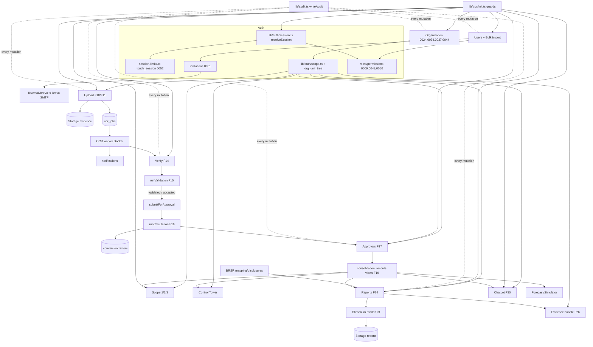

# Implementation handover

Audit date: **2026-10-29**. Branch: `feature-scoped-admins` (base `fe93b23` = `main` = live Vercel production).
Purpose: continue coding from the exact point where work stopped. This file covers the **current code**;
history is in `PROGRESS.md`, live state in `CONTEXT.md`, reasons in `.grill/`. No secrets appear here.

---

## 0. State at a glance

| Fact | Evidence (checked 2026-10-29) |
|---|---|
| Last commit anywhere: `fe93b23` (2026-10-12) | `git log`; `main`, `origin/main`, `ucn/main` all equal |
| Live production = `fe93b23` | Vercel project `ps08-brsr-meil`, deployment `dpl_65kjATE8…`, state READY |
| **Uncommitted: stages 1–3** (Super Admins + Administrators, invitation links, session limits) | 68 modified + 17 new files, +1666/−426 lines; nothing edited after 2026-10-13 08:05 |
| Migrations `0050`–`0052` exist only in the working tree | `supabase/migrations/005{0,1,2}_*.sql`, untracked; local DB only, **not on hosted** |
| Unit tests 210/210, typecheck clean, lint 0 errors (6 `` warnings), Prettier clean | Re-run today on the working tree |
| Database / end-to-end / browser suites **not re-run today** | Docker Desktop is not running; last results are from 2026-10-13 (below) |
| **Hosted OCR worker is down** | It is a container on this machine (`traceesg-ocr-worker-hosted`); Docker is not running, so hosted uploads stay in "Processing" |
| Owner's dev server (port 3000, hosted DB) breaks with this working tree | `resolveSession` calls `touch_session` (migration `0052`), which hosted lacks |

---

## 1. Architecture you must know before touching anything

```
apps/web (Next.js 16, React 19, tRPC 11, postgres.js, Supabase Auth)   apps/ocr-worker (Python 3.12, PaddleOCR)
  app/**/page.tsx  ── server components, call requireXSession()             worker/__main__.py → processor.process_next
  app/**/actions.ts ── server actions → tRPC caller (runAction)             polls ocr_jobs (FOR UPDATE SKIP LOCKED)
  app/api/trpc/[trpc] ── tRPC HTTP                                           writes ocr_extractions/fields, notifications
  lib/trpc/routers/* ── all business procedures                              extraction/profiles.py EXTRACTOR_VERSION rules-13
  lib/db.ts ── service connection (BYPASSES RLS)                       supabase/ (Postgres + Storage + Auth)
  lib/auth/* ── session, scope, invitations, session clock                migrations 0001–0052, pgTAP tests
```

**Auth and permission layers** (`lib/trpc/init.ts`, `lib/auth/session.ts`):

| Guard | Who passes | Used by |
|---|---|---|
| `protectedProcedure` / `requireActiveSession` | `status === "active"` (signed in, provisioned, active, session clock alive, no forced password change) | everything |
| `permissionProcedure(code)` | Super Admin, or a role holding `code` | most routers |
| `adminAreaProcedure` / `requireAdminAreaSession` | Super Admin **or** Administrator (`org_admin`) | records, scope totals, users, organization pages |
| `adminProcedure` / `requireAdminSession` | Super Admin only (`session.isAdmin`) | factors-free config: OCR monitoring, deadlines, BRSR disclosures, report inputs |

`resolveSession` statuses: `anonymous | expired | deactivated | unprovisioned | password_change_required | active`.
Anything new that reads the session must treat every status except `active` as no access.

**Org scope rule:** `lib/db.ts` bypasses RLS, so any procedure taking an org unit / record / report id must
call `lib/auth/scope.ts` (`scopedOrgUnitIds`, `inOrgScope`, `assertOrgScope`, `defaultOrgUnitId`). Scope is
computed through `org_unit_tree` (a unit can have several parents since `0044`). Never walk `parent_id` alone.

**Roles** (seeded): `admin` (Super Admin, max 2), `org_admin` (Administrator, new in `0050`), `corporate_esg`,
`ehs`, `finance_csr`, `hr`, `procurement`, `project_manager`, plus custom roles (e.g. hosted `emp`).
**Permissions (20):** `approval.decide audit.view brsr_mapping.manage carbon_credit.manage carbon_credit.view
chat.use document.upload factor.manage icp.manage monitoring.view org.bulk_import org.manage period.manage
record.verify report.generate role.manage settings.manage user.bulk_import user.manage validation.review`.

---

## 2. Feature inventory

Status key: **V** implemented and verified · **VP** implemented, verification pending · **P** partially
implemented · **UI** UI only / placeholder · **PL** planned / not implemented · **B** broken / regressed.
"Verified" means a recorded passing run of an automated suite against a real database **and** (where it has
a screen) a browser or real-procedure check. Unit tests alone never count as verified.

### 2.1 Summary table

| # | Feature | Status | Strongest evidence |
|---|---|---|---|
| F1 | Sign-in, sign-out, password policy, forgot/OTP reset | V | e2e `authorization.mjs`, `audit-regression.mjs`; Edge pass 2026-10-12; `tests/password-policy.test.ts` |
| F2 | Super Admins and scoped Administrators (stage 1) | P (local only) | e2e `scoped-admin.mjs` 77/77, DB `super_admin_and_administrators.test.sql`; 3 decided items not built |
| F3 | Invitation links (stage 2) | VP (local only) | e2e `invitations-sessions.mjs` (98 checks, real mail catcher); never through Brevo, never on hosted |
| F4 | Session time limits (stage 3) | VP (local only) | same e2e (clock moved in DB); no real 3 h wait; never on hosted |
| F5 | Organization hierarchy (levels, shared units, groups, delete) | V | DB `shared_org_units.test.sql`, `audit_p2_levels`; 25/25 real procedures; Organization page not viewed in a browser after the last rounds |
| F6 | User management (invite, assignments, deactivate, delete) | V (old path) / VP (new link path) | e2e A–F set-up uses it; 20/20 delete procedure checks |
| F7 | Roles & permissions matrix, Edit role, uploads-for-role | V | DB `role_permission_defaults.test.sql`; 15/15 + 18/18 procedure checks; not viewed in a browser |
| F8 | Bulk import (users, org units, Excel templates, hierarchy export) | VP | `bulk-import-parse.test.ts`; 34/34 + 9/9 real procedure; templates never opened in Excel by the agent |
| F9 | Reporting periods | V | e2e Phase 4 suite; `lib/periods/rules.ts` |
| F10 | Document upload (single file) | V | e2e A–F; August run on hosted: 57 files |
| F11 | Multi-bill PDF split | V | e2e Scenario E; 6 PDFs split on hosted |
| F12 | Supporting evidence files | V | e2e Scenario A (P2 checks) |
| F13 | OCR worker (extraction, classification, notifications) | V (synthetic + 1 real TPCODL bill) | worker unit 44/44, harness 9/9 (last run Phase 13/multi-bill), 63/63 test-set docs |
| F14 | Verify Extraction (guard rail, manual exception, reject) | V | e2e A–C; `verification-rules.test.ts` |
| F15 | Validation engine + Validation Queue | V | `validation-checks.test.ts`, DB phase 8, e2e |
| F16 | Calculation engine + conversion factors | V | `calculation-*.test.ts`, DB phase 9, determinism check in e2e |
| F17 | Approval workflow (queues, self-approval rules) | V (old rules) / VP (Super Admin own-approval mark) | e2e approvals; `scoped-admin.mjs` |
| F18 | Scope 1/2/3 dashboards | V | e2e A, B, F; Edge passes |
| F19 | Consolidation (roll-up, FY, % from counts) | V | DB phase 15, e2e 35/35, chatbot totals 39/39 |
| F20 | Control Tower, KPI trends, reminders | V (Control Tower) / VP (trends, reminders) | e2e Phase 16 63/63; reminders never sent through the app |
| F21 | Submission Monitoring + Data Explorer (+ search) | V | e2e Phase 16; search 12/12 on local DB; CSV export (not yet Excel) |
| F22 | BRSR mapping + readiness | V | DB phase 14, e2e |
| F23 | BRSR Disclosures (146 questions, typed answers) | VP | DB `full_brsr_format.test.sql`; screen never clicked through |
| F24 | Report generation (PDF, snapshot v4, custom period) | V | e2e Scenario D; 3 reports generated on live Vercel 2026-10-12 |
| F25 | Report drill-down (value → document) | V | Phase 17 browser 9/9 |
| F26 | Audit evidence bundle (ZIP, checksums) | V | `audit-regression.mjs`: 36 files with verified checksums |
| F27 | Audit trail + append-only log | V | DB phase 18, e2e 54/54 |
| F28 | Notifications (bell, page) | V | e2e Phase 6 |
| F29 | Profile + theme toggle | V | Phase 19 browser 30/30 |
| F30 | ESG analyst chatbot | V locally / **off on hosted** | `test:chatbot` 49/49 (scripted model); real model 28/28 browser pass; `chat_reader` has no password on hosted |
| F31 | Emissions forecast | VP | `forecast.test.ts` only; page Super Admin only |
| F32 | Reduction simulator | VP | `simulator.test.ts` only |
| F33 | Carbon credits ledger + internal carbon price | VP | `carbon-credits.test.ts`, DB `audit_3_data_isolation` (over-draw trigger); no section in PROGRESS.md |
| F34 | Reporting deadlines + escalation sweep | VP | `deadlines.test.ts`; sweep runs only on a button, no scheduler |
| F35 | Security hardening (CSRF origin, rate limits, headers, HttpOnly cookies) | V | `security.test.ts`, e2e Phase 18, audit-regression |
| F36 | Landing page + public site | V (visual) | UI audit 2026-10-12, a11y 188/0/2 |
| F37 | Accessibility test harness | V | `test:a11y` 188 passed, 2 known open |
| F38 | Vercel deployment config | V | live; `next.config.ts` file tracing, `lib/pooler-url.ts`, `lib/reports/pdf.ts` |
| F39 | Stage 4: org-tree picker, Scope filters, Excel exports | PL | `.grill/scoped-admin-onboarding-decisions.md` |
| F40 | Stage 5: demo request, `/docs`, signed-in help (migration `0053`) | PL | same |
| F41 | Stage 6: phone/tablet pass, security regression, docs | PL | same |
| F42 | MFA for Super Admins | PL (deferred by owner) | same, "Out of scope" |
| — | Owner's dev server on hosted DB with this tree | **B** (environmental) | `touch_session` missing on hosted; fixed by applying `0051`/`0052` |

### 2.2 Feature details

Format per feature: **Behaviour → Frontend → Backend → Database → Access → Dependencies → Validation →
Verification → Limitations.** Paths are relative to `apps/web/` unless they start with `supabase/` or
`apps/ocr-worker/`.

#### F1 Sign-in, sign-out, passwords
- **Behaviour:** email + password sign-in; 5 failures per account / 50 per address per 15 min lock; after a
  forced-change mark the `/login` page shows a change-password form; sign-out ends every session of the person.
- **Frontend:** `app/login/page.tsx` + `components/ui/password-input.tsx` (show/hide); `app/forgot-password`,
  `app/reset-password`; live strength meter.
- **Backend:** `app/login/actions.ts`, `app/forgot-password/actions.ts` (6-digit code, hashed, 10 min, 5
  guesses, claimed atomically), `app/reset-password/actions.ts` (needs the marker cookie set by
  `app/auth/confirm/route.ts`), `app/auth/signout/route.ts` (also calls `endSessions`), `lib/auth/password-policy.ts`,
  `lib/auth/initial-password.ts`, `lib/security/rate-limit.ts`, `lib/supabase/cookie-options.ts` (HttpOnly).
- **Database:** `auth.users` (Supabase), `public.users`, `password_reset_otps`, `rate_limit_events`, `audit_logs`.
- **Access:** public pages. Forgot-password sends **no code** to an account never set up (stage 2 change).
- **Dependencies:** Supabase Auth; Brevo SMTP (`BREVO_*`) for the OTP email.
- **Limitations:** hosted Supabase Auth password rules and per-IP limit not set from the repo
  (`SECURITY_REVIEW.md` F8); no MFA.

#### F2 Super Admins and scoped Administrators — stage 1 (uncommitted)
- **Behaviour:** `admin` = Super Admin (group-wide config + every unit, **max 2**, enforced by DB). `org_admin`
  = Administrator of the assigned unit and everything beneath it. Administrators see Users, Organization,
  Submission Monitoring, Data Explorer, queues, Scope 1/2/3, Reports, Control Tower, Upload — limited to their
  subtree. Super-only pages are hidden from the nav **and** refused server-side.
- **Frontend:** `components/shell/admin-nav.ts` (new; `superOnly` flags, `adminNavFor`), `app/admin/layout.tsx`,
  every `app/admin/*/page.tsx` switched to `requireAdminAreaSession` or `requireAdminSession`,
  `app/admin/users/users-manager.tsx`, `app/admin/organization/org-manager.tsx`.
- **Backend:** `lib/auth/session.ts` (`isOrgAdmin`, `adminOrgUnitIds`), `lib/trpc/init.ts`
  (`adminAreaProcedure`), `lib/users/rules.ts` (`checkGrant`, `checkAccountReach`, `administeredIds`,
  `checkAdminRemoval`), `reach()` in `lib/trpc/routers/organization.ts`, scope checks added in `records.ts`,
  `scope.ts`, `reports.ts`, `approvals.ts`, `documents.ts`, `lib/documents/rules.ts` (admins upload any activity).
- **Database:** `0050_super_admin_and_administrators.sql` — `org_admin` role and grants, setting
  `super_admin_limit = 2`, function `enforce_super_admin_limit()` with triggers on `user_org_assignments` and
  `users`. `is_admin()` and all RLS policies unchanged (still mean Super Admin).
- **Grant rules:** Super Admin → any role anywhere. Administrator at X → operational roles at X and below,
  `org_admin` only strictly **below** X, never `admin`. Nobody edits their own assignments. Deactivate only when
  every assignment of the account is inside the caller's scope. Bulk import refuses admin-role rows.
- **Approvals:** nobody approves what they submitted or verified, except a Super Admin; that approval is marked
  (`selfApproval` in `routers/approvals.ts`, audit entry).
- **Verification:** web unit 204→210, DB 336→367, cross-project 264 passed (2 cannot run outside the app),
  e2e 344/344 + `scoped-admin.mjs` 77/77, eight screens in Edge as an Administrator (all 2026-10-13).
- **Not built (decided but missing → status P):** (1) the Super Admin own-approval mark in the **report
  drill-down** (it is in the audit trail and the record history only); (2) a notification to Administrators when
  a record in their scope is flagged (Super Admins still get it); (3) scoped versions of OCR Monitoring,
  Deadlines, Forecast, Simulator, Carbon credits (Super Admin only for now).
- **Hosted risk:** placement script `test data/_backup/hosted-admin-placement.cjs` must run **after** the code
  deploy (moves four hosted Admins to Administrators and records `0050`). Running it before leaves the old code
  with `org.manage` holders and no scope check.

#### F3 Invitation links — stage 2 (uncommitted)
- **Workflow:**
  1. Administrator: Admin → Users → Invite user (`users-manager.tsx`) or bulk import.
  2. `app/admin/users/actions.ts` → `users.invite` / `users.bulkImport` (`lib/trpc/routers/users.ts`).
  3. Server creates the Auth user **without a password**, the `public.users` row and assignment, then
     `lib/auth/invitations.ts` issues a token (`lib/auth/invitation-token.ts`: 32 random bytes, SHA-256 stored),
     revoking any earlier open link, all in one transaction with an audit entry.
  4. Email via `lib/email/brevo.ts` (`invitationEmailHtml`) with `NEXT_PUBLIC_APP_URL/invite#<token>`.
  5. Recipient opens `/invite` (`app/invite/page.tsx`, `accept-invitation-form.tsx`): the page reads the
     fragment, strips it from the address bar, calls `checkInvitation` (read only).
  6. Submits the password → `acceptInvitation` (`app/invite/actions.ts`): one `UPDATE … SET consumed_at` claims
     the link; Supabase Admin API sets the password; OTPs deleted; `user.invitation_accepted` audited; redirect
     to `/login?reason=password_set`. Nobody is signed in by the link.
  7. Failure: unknown, used, revoked, expired or deactivated → one generic message; wrong tokens rate-limited per
     address (`invitation_failures_per_address`); a refused password does **not** use the link up.
- **Manage panel:** `users.resendInvite` (replaces the link; for a legacy temp-password account it overwrites
  that password with a random one), `users.revokeInvite`. "Invited" = no link used and never signed in.
- **Database:** `0051_user_invitations.sql` — `user_invitations` (unique outstanding per user, trigger
  `guard_user_invitation` refuses changing account/hash/expiry or reviving), setting for 24 h validity. RLS on,
  no browser grants.
- **Dependencies:** Brevo SMTP; `EMAIL_SMTP_HOST`/`EMAIL_SMTP_PORT` (loopback only) for the local mail catcher.
- **Limitations:** never sent through real Brevo; Brevo click tracking may wrap the link (switch it off);
  `scripts/provision-user.ts` without `--password` still uses Supabase's own invite + `/auth/confirm`.

#### F4 Session time limits — stage 3 (uncommitted)
- **Behaviour:** sign-in ends after **3 h idle** or **12 h absolute** (`org_settings.session_limits`); a notice
  five minutes before; "Stay signed in" for the idle limit only; an ended session sends the open page to
  `/login` and back afterwards; expiry ends **that device only**; Log out still ends every device.
- **Frontend:** `components/shell/session-keeper.tsx` (activity listener, at most one report a minute, notice,
  redirect), mounted in `app/admin/layout.tsx` and `app/app/layout.tsx`.
- **Backend:** `lib/auth/session-limits.ts` (`currentSessionId` from the access token's `session_id`,
  `touchSession`, `endSessions`), `lib/auth/session-actions.ts` (`reportActivity`), `resolveSession` calls
  `touchSession(…, false)` on **every** request (pages, tRPC, file routes).
- **Database:** `0052_session_limits.sql` — `user_sessions` (one row per sign-in), `session_limits()`,
  `touch_session(uuid, uuid, bool)`: inserts the row on first sight, `SELECT … FOR UPDATE`, ends it on
  idle/absolute, returns the two deadlines. Sessions alive at deploy time get a fresh clock (no mass logout).
- **Limitations / risk:** one extra write + row lock per request — not yet measured on Vercel with its
  3-connection pool (`lib/pooler-url.ts`); no real 3-hour wait tested; notice not viewed in Dark/Special themes.

#### F5 Organization hierarchy
- **Behaviour:** tree with configurable levels (`org_levels`), create / edit / move / deactivate (typed
  confirmation when units sit below) / delete unused (type `delete`); a unit below group can sit under several
  parents (counts in full in each, once at the group); several groups; expected submissions per unit, inherited
  ones shown locked on the parent ("From <unit>"); Export hierarchy to Excel.
- **Frontend:** `app/admin/organization/page.tsx`, `org-manager.tsx` (tree guide lines, Shared tag with parents
  popover `SharedPlaces`, side panels), `components/bulk-import/*`.
- **Backend:** `lib/trpc/routers/organization.ts` (`levels addLevel renameLevel removeLevel tree impact create
  update move addParent removeParent setParents deleteCheck delete setStatus expectations setExpectation
  bulkImportOptions bulkImport`), `lib/org/rules.ts` (`canBeChildOf`, `checkMove`, `importOrder`,
  `mergeSharedRows`, `unitByRef`), `lib/org/nodes.ts`, `lib/org/levels.ts`.
- **Database:** `org_units`, `org_levels` (`0037`), `org_unit_parents` + views `org_unit_tree` (`0023`, `0044`),
  `submission_expectations` (`0024`), hierarchy trigger (`0034`).
- **Access:** `org.manage` (+ Administrator reach); levels Super Admin only; `org.bulk_import`.
- **Limitations:** latest UI rounds (checkbox parents, popover in side panel) never viewed in a browser.

#### F6 User management
- `app/admin/users/*` → `users` router (`options list invite resendInvite revokeInvite addAssignment
  revokeAssignment deactivate delete reactivate`). Delete refuses only when real work exists and names it;
  otherwise removes traces, keeps a hidden profile row (`deleted_at`) when the audit log names the person.
  Tables: `users`, `user_org_assignments`, `user_invitations`, `audit_logs`. Access: `user.manage` + reach rules
  (F2). Last active Super Admin cannot be removed (three guards).

#### F7 Roles & permissions
- `app/admin/roles` → `roles` router (`matrix create update setPermissions delete`). `roles.uploads_for_role_id`
  (`0049`): a role (hosted `emp`) uploads on behalf of another (Project Manager); `lib/documents/rules.ts`
  `uploadTargets`. Role defaults `0048` (Corporate ESG gets `validation.review`, `report.generate`). Super Admin only.

#### F8 Bulk import
- `/app/users/bulk-import`, `/app/org-units/bulk-import`, embedded in Users / Organization side panels.
  Templates written by `exceljs` (`lib/bulk-import/xlsx.ts`, dropdowns, Parent code takes several parents comma
  separated), filled sheets parsed in the browser by `xlsx` (SheetJS 0.20.3 from the vendor's site); each row its
  own transaction; results CSV. Users now get an **invitation link** (no password).
- **Limitations:** results export is CSV (stage 4 plans `.xlsx`); templates not opened in Excel by the agent.

#### F9 Reporting periods
- `app/admin/reporting-periods` → `reportingPeriods` router (`list create updateWindow transition`); reopening
  needs a reason and warns about report runs; `lib/periods/rules.ts`. Table `reporting_periods`. `period.manage`.

#### F10 Document upload — the main entry point
1. User opens `/app/upload` (`app/app/upload/page.tsx`, `components/upload/*`); the open period is found
   automatically (`dashboard.openPeriod`), unit and activity pickers come from `documents.uploadOptions`
   (role-filtered; admins see every activity; `uploads_for_role_id` honoured).
2. `documents.prepareUpload` checks scope, period, metric, duplicates (same hash anywhere, same unit+period+metric)
   and returns a Supabase **signed upload URL** (`lib/trpc/routers/documents.ts:392`).
3. Browser PUTs the bytes straight to the private `evidence` bucket (progress bar, cancel, retry).
4. `documents.completeUpload` re-reads the bytes, recomputes SHA-256, sniffs the real type, refuses truncated or
   encrypted PDFs (`lib/storage/evidence.ts` `checkFileContent`), re-checks scope/period, then in **one
   transaction** inserts `documents`, `esg_records` (`document_uploaded`), `esg_record_documents`, `ocr_jobs` (pending)
   and the audit entry (`:520`).
5. UI shows the animation; record appears in My Submissions as Processing.
- **Failure:** wrong type/size/encrypted → inline error, nothing written; duplicates → warnings that must be
  acknowledged (never blocked); 60 uploads / 10 min per user.
- **Access:** `document.upload`. **Tables:** `documents`, `esg_records`, `esg_record_documents`, `ocr_jobs`.

#### F11 Multi-bill PDF split
- Upload mode "A PDF with several bills" → `bundles` router (`prepareUpload completeUpload pending discard review
  confirm`); worker `_propose_bundle` proposes parts (`document_bundle_parts`, `0032`); uploader confirms on
  `/app/upload/split/[documentId]`; each kept bill is cut out by `pdf-lib` (`lib/documents/split-pdf.ts`) and
  recorded like F10 (`bundles.ts:553`). Rules shared browser/server (`lib/documents/bundle.ts`). ≤ 20 pages, PDF
  only, one period per PDF, consecutive bills of one type look like one.

#### F12 Supporting evidence files
- `documents.prepareSupporting` / `completeSupporting` / `recordEvidence` (verify screen, record drawer) until the
  record is approved or rejected; OCR never reads them.

#### F13 OCR worker (`apps/ocr-worker`)
- `python -m worker` → `processor.process_next`: claims a job (`FOR UPDATE SKIP LOCKED`, claim token, stale
  reclaim after 15 min, 3 attempts), downloads from Storage, renders PDF pages (pypdfium2), PaddleOCR
  (PP-OCRv5 mobile, CPU, detector capped at 1600 px), deterministic extraction `extraction/fields.py` driven by
  `metric_field_requirements` + `extraction/profiles.py` (labels, patterns, units, utility list, `rules-13`),
  classification among the metric's document types; one transaction writes `ocr_extractions`,
  `ocr_fields`, job `completed`, document `ready`, record `ocr_completed`, the uploader's notification
  (`verification_needed` / `low_confidence` / `ocr_failed`). Missing fields stay null — never guessed.
- **Deploy:** Docker image `traceesg-ocr-worker:latest` (`5ee1ae92263e`, models baked in). **Only host today is
  this machine's Docker** — currently stopped. A worker newer than the database fails every job: migrate first.
- **Limitations:** real-document accuracy proven on one TPCODL electricity bill only; a lone digit on a line is
  not detected; no real water bill tried.

#### F14 Verify Extraction
- `/app/verify/[documentId]` (split screen: pdf.js/image left, fields right) → `verification` router (`load
  setDocumentType invoiceDuplicates confirm confirmManual reject`), rules `lib/verification/rules.ts`
  (`checkConfirm`, threshold from `org_settings.ocr_confidence_threshold` = 80). Confirm blocked until every
  flagged field is edited or acknowledged, required fields filled, numbers valid, document type chosen,
  duplicates acknowledged — the same checks run on the server. Confirm writes verified values, `verifications`,
  record values and then **calls `runValidation` in the same transaction** (`verification.ts:591`, `:720`).
  Reject needs ≥ 10 characters; manual exception needs ≥ 20. Access: `record.verify` / own upload, scope via
  `lib/verification/access.ts`.

#### F15 Validation
- `lib/validation/engine.ts` `runValidation`: built-in format, organizational, evidence checks + configured
  `validation_rules` (units, > 0, billing-period overlap, duplicate invoice, duplicate grid bill, not-greater-than,
  history ratio ×2 / ½ of median over 3+ periods). One `validation_results` row per check. `failed` → returned
  to submitter with notification; `flagged` → Validation Queue (`/admin/validation-queue`, `validation.review`,
  Accept → `submitForApproval`, or Return); `validated` → `submitForApproval` (`engine.ts:278`).

#### F16 Calculation + conversion factors
- `lib/approvals/workflow.ts` `submitForApproval` → `lib/calculation/engine.ts` `runCalculation`: unit
  normalisation (`units.ts`), factor version effective for the period (latest `effective_from` among active and
  superseded), formula (`direct_multiply`, `subtract`, `percentage`), append-only `calculations` row with factor
  snapshot and `ENGINE_VERSION`. Missing factor → "Not calculated", Approve disabled, Admin notified, "Run
  calculation" later (`factors.recalculate`). Factors at `/admin/conversion-factors` (`factors` router,
  `factor.manage`); a used version can never change (trigger).
- **Data gap:** hosted has 29 factors; **9 August records wait** for factors that have no sourced value (PNG,
  steam, heat/cooling, waste, spend-based).

#### F17 Approvals
- `/app/approvals` and `/admin/approval-queue` → `approvals` router (`queue decide`). Approver scope = Super
  Admin all, else subtrees where a role holds `approval.decide`. Self-approval refused except Super Admin
  (marked). Approve disabled without a calculation when one is required. Notifies the submitter.

#### F18 Scope 1/2/3 dashboards
- `/admin/scope-1|2|3` (one component, scope code parameter) → `scope.getTotal` (`adminAreaProcedure`, scope
  checked), `scope.recordTrace`, `scope.myTotal` for the user dashboard. Approved headline; awaiting and
  not-calculated beside; per-child bars; trend; drill to record → trace → original document. Scope 3 shows
  "6 of 10 active". Reads `consolidation_records`.

#### F19 Consolidation
- `lib/consolidation/query.ts` `consolidateNodes`, `aggregate.ts`; views `org_unit_tree`, `consolidation_records`
  (`0023`, `0044`). Period or Indian FY; percentages re-derived from summed counts; units never mixed; shared
  units counted once at the group. `consolidation.query` (`protectedProcedure`, scope enforced).

#### F20 Control Tower, KPI trends, reminders
- `/admin` (`app/admin/page.tsx`) → `records.summary`, `records.kpiTrends` (`monitoring.view`),
  `lib/dashboard/kpis.ts` (`readiness`, weights `org_settings.brsr_readiness_weights`), issue panel predicates
  shared with landing lists (`lib/records/search.ts`). "Send reminders" → `records.remindMissing` (in-app + email,
  audited). Reminders never exercised through the app.

#### F21 Submission Monitoring + Data Explorer
- `/admin/submissions`, `/admin/data-explorer` → `records.search|missing|detail`; URL params read by
  `lib/records/params.ts`; free-text `q` matched on the server in `recordsFrom`; record drawer
  (`components/records/*`); CSV export with formula neutralisation (`lib/csv.ts`). Stage 4 replaces CSV with
  server-generated `.xlsx`.

#### F22–F23 BRSR mapping, readiness, disclosures
- `/admin/brsr-mapping` → `brsr.mappings|readiness` + mutations under `brsr_mapping.manage`; `lib/brsr/readiness.ts`.
  `/admin/disclosures` → `brsr.disclosures|saveDisclosure` (Super Admin). Tables `brsr_indicators` (146 questions,
  `0040`), `brsr_metric_mappings`, `brsr_disclosures`, SDG tags (`0039`). Hosted holds 23 answers from public sources;
  boundary, contact person, assurance, PPP rate are empty.

#### F24–F25 Reports and drill-down
- `/admin/reports` → `reports.generate` inserts a `report_runs` row and returns; `after(() => runReport(runId))`
  (`reports.ts:280`) → `lib/reports/generate.ts` → `buildSnapshot` (snapshot v4, all 146 questions, previous-year
  column, SEBI tables, gas break-up, consolidation per child, methodology) → `renderReportHtml` → `renderPdf`
  (`puppeteer-core` + `@sparticuz/chromium` headless shell on Vercel; Edge locally via `CHROMIUM_EXECUTABLE_PATH`)
  → private `reports` bucket; notification "Report ready" or failure reason; stale runs failed after 10 min.
  Custom period: `period_from`/`period_to` (`0043`). Inputs per FY (turnover, PPP, assurance) via `reports.inputs`
  / `saveInputs`. Detail `/admin/reports/[reportId]`: value → indicator → metric → calculation → record →
  document (`reports.reportedRecord`). File route `app/api/reports/[reportId]/file/route.ts`.
- **Access:** `report.generate` + org scope. **Known:** FY report needs ≥ ~5 DB connections; Vercel pool is 3 with
  5 s idle (`lib/pooler-url.ts`), checked on three live reports.

#### F26 Audit evidence bundle
- `/admin/reports/bundle` preview (`reports.bundlePreview`) → `app/api/reports/bundle/route.ts` streams a ZIP from
  `lib/reports/bundle.ts`: lineage metric → calculation → factor → record → OCR → document, `manifest.json`,
  `checksums.sha256`, `limitations/missing-evidence.csv`; fingerprints re-checked against upload hash; audited
  `report.evidence_bundle_exported`. Needs `report.generate` + scope.

#### F27 Audit trail
- `/admin/audit-trail` → `audit.options|query|record` (`audit.view`, Super Admin in nav); keyset paging with a
  text cursor; CSV export. `audit_logs` is append-only for every role (`0027`); entries carry IP, user agent,
  session (`0036`). Written through `lib/audit.ts` `writeAudit` inside the same transaction as the change.

#### F28–F29 Notifications, profile, theme
- Bell polls every 30 s (`lib/notifications/actions.ts`, `notifications` router), `/app/notifications`.
  Profile: `profile.updateDisplayName|setTheme|changePassword`; themes `theme-1/2/3` in `users.theme`, top-bar
  toggle, no-flash script (`lib/theme.ts`).

#### F30 ESG analyst chatbot
- Top-bar "Ask" + docked `<aside>` (`components/chat/*`, `chat-launcher.tsx`) → `chat.send` (`chat.use`) →
  `lib/chat/orchestrate.ts` `answerQuestion`: OpenAI-style tool calling against NVIDIA NIM (`lib/chat/nim.ts`,
  `NVIDIA_NIM_API_KEY`, `NVIDIA_NIM_MODEL` list, `NVIDIA_NIM_BASE_URL`); 9 read-only tools (12 for a Super Admin:
  `list_people`, `list_records`, `open_report_page`) in `lib/chat/tools.ts`, run on a `chat_reader` connection
  (`CHAT_DATABASE_URL`, SELECT on a named list only) except the Admin tools; figures come from the app, the model
  only words them (`unmatchedNumbers` check). Conversations `chat_conversations`/`chat_messages`, 90 days.
  20 questions / 10 min. Emails, employee ids, file names are not sent to the model.
- **Status on hosted:** off — `chat_reader` has no password and `CHAT_DATABASE_URL` is not set.

#### F31–F32 Forecast and simulator
- `/admin/forecast` → `forecast.options|getForecast` → `lib/forecast/engine.ts` (linear trend, exponential
  smoothing, chronological backtest, prediction interval) over `consolidation_records`.
  `/admin/simulator` → `simulator.options|baseline` → `lib/simulator/engine.ts` (A = B × r/100, three standard
  scenarios + custom), read-only, banner "SIMULATION — NOT OFFICIAL BRSR DATA".
- Pages are Super Admin only; procedures are `protectedProcedure` with their own scope check for non-admins.
- **Defect (latent):** the non-admin unit list in `forecast.ts` / `simulator.ts` `options` walks `parent_id`
  recursively, so a unit shared under a second parent is missing for a person assigned at that parent. Not
  reachable today (pages are Super Admin only) — fix before opening them to Administrators.

#### F33 Carbon credits and internal carbon price
- `/admin/carbon-credits` → `carbonCredits` router (`options summary list mint retire transfer reconciliation
  icpList icpCreate evaluateCapex`), `lib/carbon-credits/engine.ts`; migration `0046`; batches cannot be
  over-drawn (trigger, `0047`); `carbon_credit.view|manage`, `icp.manage`; scope-checked.
- **Limitations:** with no configured price the page shows an invented Rs 2,500 (owner decision pending);
  not described in PROGRESS.md; no e2e or browser run recorded.

#### F34 Reporting deadlines
- `/admin/deadlines` → `deadlines.list|kpis|runSweep|remindTask` → `lib/deadlines/service.ts`
  (`executeEscalationSweep`, `sendManualTaskReminder`). **The sweep runs only when the button is pressed** —
  `vercel.json` has no cron. Super Admin only. Dates are not called "statutory".

#### F35 Security hardening
- `lib/security/origin.ts` (tRPC mutations refused unless `Origin` is the app's host), `rate-limit.ts`
  (`org_settings.rate_limits`, hashed bucket names), `next.config.ts` headers (CSP, HSTS, no framing,
  `X-Powered-By` off; not applied under `/api`, each route sets its own), API answers `private, no-store`,
  evidence route `app/api/documents/[documentId]/file/route.ts` scope-checked + sandboxed + fingerprint-checked.
  Open: client address for rate limits behind the proxy (Medium), inline scripts in CSP (Medium), 18 Low
  (`FINAL_VERIFICATION_2026-10-12.md`).

#### F36–F38 Landing page, accessibility harness, Vercel config
- Landing: `app/page.tsx`, `components/landing/*`, brief `docs/LANDING_PAGE_BRIEF.md`; custom cursor sitewide
  (accessibility decision pending). `pnpm --filter web test:a11y` (axe-core in Edge, 31+ routes × 3 themes).
  Vercel: region `bom1`, `outputFileTracingIncludes` for the report browser, `lib/app-url.ts`,
  `lib/pooler-url.ts`; `CHROMIUM_EXECUTABLE_PATH` must **not** be set there. Guide: `DEPLOYMENT.md`.

---

## 3. Feature dependency map



**Shared modules whose change breaks many features:**

| Module | Breaks if changed carelessly |
|---|---|
| `lib/auth/session.ts` (`resolveSession`) | every page, procedure and file route; now also needs `touch_session` in the DB |
| `lib/trpc/init.ts` guards | all routers |
| `lib/auth/scope.ts`, view `org_unit_tree` | data isolation everywhere (procedures read through `lib/db.ts`, which bypasses RLS) |
| `lib/approvals/workflow.ts` → `lib/calculation/engine.ts` | verification, validation queue, factors recalculation, all totals |
| views `consolidation_records` (`0023`/`0044`) | Scope pages, Control Tower, reports, chatbot, forecast, simulator, carbon reconciliation |
| `lib/audit.ts` + append-only triggers | every mutation (a failing audit write rolls the change back) |
| `metric_field_requirements` + `worker/extraction/profiles.py` | OCR, verify screen, validation, calculation inputs |
| `lib/email/brevo.ts` | invitations, OTP reset, reminders |
| `lib/db.ts` / `lib/pooler-url.ts` | everything on Vercel (pool size 3 stalls a FY report if reduced) |

---

## 4. The latest task

- **Requested** (owner, 2026-10-13; `.grill/scoped-admin-onboarding-decisions.md`): a six-stage plan; then
  "implement stage 2 and 3" while stage 1 was still uncommitted. So stages 1–3 sit in one working tree.
- **Implemented:** everything in F2, F3, F4 above; plus `tests/e2e/scoped-admin.mjs`, `tests/e2e/invitations-sessions.mjs`,
  `tests/scoped-admin.test.ts`, `tests/invitations.test.ts`, two pgTAP files, Mailpit SMTP port 55325 in
  `supabase/config.toml`, a 24px target fix on the Audit Trail, docs D41–D43 / A37–A39 / `UI_NOTES.md`.
- **Files:** 68 modified (routers `approvals documents organization records reports scope users`, `lib/auth/*`,
  `lib/trpc/init.ts`, `lib/documents/rules.ts`, `lib/email/brevo.ts`, `lib/security/rate-limit.ts`, ~20 admin
  pages, layouts, `users-manager.tsx`, `org-manager.tsx`, `employee-bulk-import.tsx`, `approval-queue.tsx`, docs)
  and 17 new (listed in `git status`).
- **Meets the requirements?** Stages 2 and 3: yes, as decided, locally. Stage 1: **not fully** — the own-approval
  mark in the report drill-down, the flag notification to Administrators, and scoped OCR Monitoring / Deadlines /
  Forecast / Simulator / Carbon credits are missing (documented as "not built").
- **Unfinished:** not committed, not on hosted, not merged, not deployed; the owner has not confirmed the
  agent's own stage 2–3 decisions; no real Brevo email; tablet width and Dark/Special themes not viewed.
- **Exact resume point:** owner go-ahead for the hosted step, then commit (see §6 step 1).

---

## 5. Known bugs, risks and limitations (current code)

| # | Item | Severity | Where |
|---|---|---|---|
| 1 | Working tree + hosted DB = every signed-in page fails (`touch_session` missing) | High until `0052` is on hosted | `lib/auth/session.ts:80` |
| 2 | Hosted OCR worker down while Docker on this laptop is off; no always-on host | High for any demo | `CONTEXT.md` §4 |
| 3 | 9 hosted records cannot be approved: no factor exists | Medium (data) | `/admin/conversion-factors` |
| 4 | Chatbot off on hosted (`chat_reader` password, `CHAT_DATABASE_URL`) | Medium | `0042` |
| 5 | Per-request write/lock in `touch_session` not load-checked on Vercel's 3-connection pool | Medium (risk) | `0052`, `lib/pooler-url.ts` |
| 6 | Forecast/Simulator non-admin options walk `parent_id` (misses shared units) | Low (latent) | `routers/forecast.ts`, `routers/simulator.ts` `options` |
| 7 | Deadline escalation never runs by itself | Low | `vercel.json` (no cron) |
| 8 | Carbon page shows an invented Rs 2,500 price when none configured | Low (honesty) | carbon credits page |
| 9 | Stage 1 items not built (drill-down mark, Administrator flag notification, scoped special pages) | Medium | F2 |
| 10 | `provision-user` without `--password` still uses Supabase's GET-consumed invite | Low | `scripts/provision-user.ts` |
| 11 | e2e, isolation, chatbot and a11y suites are not in CI; CI DB job has not run since the workflow change | Medium | `.github/workflows` |
| 12 | Lint: 6 `` warnings | Cosmetic | lint output |
| 13 | Real-document OCR accuracy proven on one bill type | Medium | F13 |
| 14 | MFA absent; `admin@meil.local` is a shared login without a mailbox | Accepted risk (owner) | F2 |

---

## 6. Where to resume

### 6.1 Leave alone (complete, verified, shared by many features)
Upload → OCR → verify → validate → calculate → approve pipeline (F10–F17), consolidation (F19), reports and
drill-down (F24–F25), audit trail (F27), security hardening (F35), Vercel pooling/PDF fixes (F38). Change these
only with the full e2e suite run afterwards.

### 6.2 Needs verification (code exists, success not established)
F3/F4 on hosted and with real Brevo; F8 templates in Excel; F20 reminders through the app; F23 Disclosures in a
browser; F30 on hosted; F31–F34 in a browser with real data; F5 latest Organization UI rounds in a browser.

### 6.3 Partially implemented
F2 (three stage-1 items); Scope 3 (6 of 10 categories); factors for PNG, steam, heat, waste, spend-based.

### 6.4 Bugs to fix
§5 rows 1, 2 (operational), 6 and 7 (code).

### 6.5 The three next coding actions

**1. Land stages 1–3 (commit → hosted → merge → deploy → placement)** — needs the owner's "go" at each hosted step.
- Files: whole working tree on `feature-scoped-admins`; scripts `test data/_backup/hosted-invitations-sessions.cjs`
  and `hosted-admin-placement.cjs`.
- Steps: start Docker + local stack; re-run `pnpm db:test`, `pnpm --filter web test:e2e` (needs Mailpit and
  `EMAIL_SMTP_HOST/PORT`), `test:isolation`, `test:chatbot`, build; commit; `node …/hosted-invitations-sessions.cjs
  apply` (`0051`, `0052`); push, PR to `main` (CI green); merge → Vercel deploys; `hosted-admin-placement.cjs
  apply` (`0050` + four Administrators); Super Admin invites the second Super Admin from Admin → Users.
- Acceptance: hosted history shows `0050`–`0052`; owner's dev server signs in; an invitation email arrives
  through Brevo, the link sets a password once and a second use is refused; an Administrator at a project sees
  only that project in Users, Data Explorer and Scope pages; a third Super Admin is refused (23514).
- Test: the commands above, then a manual pass on the live URL (invite, accept, sign in, idle notice by
  temporarily setting `session_limits.idle_minutes` low on hosted and restoring it).

**2. Finish stage 1's missing items before stage 4**
- Files: `lib/reports/snapshot.ts` + `app/admin/reports/[reportId]/page.tsx` (add `submitted and approved by the
  same person` to the drill-down from the approval's self-approval flag); `lib/validation/engine.ts` (notify
  Administrators whose `adminOrgUnitIds` cover the record's unit, through `org_unit_tree`, alongside Super
  Admins); `routers/forecast.ts`, `routers/simulator.ts` (replace the `parent_id` walk with `org_unit_tree` /
  `scopedOrgUnitIds`, then decide with the owner which special pages open to Administrators).
- Acceptance: the drill-down shows the mark only for Super Admin self-approvals; an Administrator gets the
  `validation_review` notification for a flagged record in scope and not for one outside; a shared unit appears
  in Forecast options under both parents.
- Test: extend `tests/e2e/scoped-admin.mjs`, add a pgTAP or isolation check, unit tests for the options query.

**3. Stage 4 — org-tree picker, Scope 1/2/3 filters, Excel exports**
- Files: new picker in `components/` (ui lane; record in `UI_NOTES.md`), `app/admin/scope-*/page.tsx`,
  `lib/trpc/routers/scope.ts` (activity/source filter, consolidated vs this-unit switch), new server routes for
  `.xlsx` exports replacing `lib/csv.ts` use in records, audit log (Super Admin only) and both bulk-import results;
  `exceljs` already a dependency. Evidence bundle ledgers stay CSV.
- Acceptance (from the decision log): every row matching the filter, a header block (unit, period, filters, who,
  when), typed cells, no internal ids, formula-injection guard, scope-checked, audited; picker cascades through
  the real hierarchy including shared units.
- Test: unit tests for the sheet builder; isolation test that a Project X user cannot export a sibling's rows;
  open each file in Excel; e2e for one export per kind.

---

## 7. Verification evidence ledger

| Suite | Last result | When | Command |
|---|---|---|---|
| Web unit | 210/210 | **2026-10-29** | `pnpm test` (in `apps/web`) |
| Typecheck / lint / format | pass / 0 errors 6 warnings / pass | **2026-10-29** | `pnpm typecheck`, `pnpm lint`, `pnpm format:check` |
| Database (pgTAP) | 367/367 | 2026-10-13 | `pnpm db:test` |
| End-to-end (11 scripts) | 519/519 | 2026-10-13 | `pnpm --filter web test:e2e` |
| Cross-project isolation | 264 passed (2 n/a outside the app) | 2026-10-13 | `pnpm --filter web test:isolation` |
| Chatbot (scripted hostile model) | 49/49 | 2026-10-13 | `pnpm --filter web test:chatbot` |
| Accessibility | 188 passed / 0 failed / 2 known open | 2026-10-13 | `pnpm --filter web test:a11y` |
| Worker unit + Ruff | 44/44 | 2026-10-12 (in image) | see `CONTEXT.md` §6 |
| OCR integration harness | 9/9 | multi-bill work (2026-10-05) | `apps/ocr-worker` harness |
| Production build | pass | 2026-10-13 | `pnpm build` |
| Live: 3 reports generated on Vercel; August run 66 records | — | 2026-10-12 | hosted |

Database, e2e, isolation, chatbot, a11y and build were **not** re-run on 2026-10-29 (Docker not running).

---

## 8. Environment variable names (values live in git-ignored env files)

Web: `NEXT_PUBLIC_SUPABASE_URL NEXT_PUBLIC_SUPABASE_ANON_KEY SUPABASE_SERVICE_ROLE_KEY DATABASE_URL
SUPABASE_STORAGE_BUCKET_EVIDENCE SUPABASE_STORAGE_BUCKET_REPORTS NEXT_PUBLIC_APP_URL CHROMIUM_EXECUTABLE_PATH
SENTRY_DSN BREVO_API_KEY (holds the SMTP key) BREVO_SENDER_EMAIL BREVO_SENDER_NAME BREVO_SMTP_LOGIN
EMAIL_SMTP_HOST EMAIL_SMTP_PORT NVIDIA_NIM_API_KEY NVIDIA_NIM_MODEL NVIDIA_NIM_BASE_URL CHAT_DATABASE_URL`;
build/test only: `NEXT_DIST_DIR E2E_ENV_FILE E2E_PYTHON`. Worker: `DATABASE_URL NEXT_PUBLIC_SUPABASE_URL
SUPABASE_SERVICE_ROLE_KEY SUPABASE_STORAGE_BUCKET_EVIDENCE` (+ optional `SENTRY_DSN`).

_Keep this file in step with the code: update §0, §2.1 statuses, §4 and §6 whenever a stage lands._
