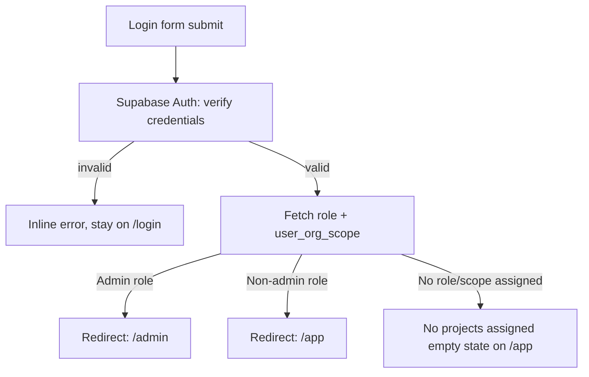
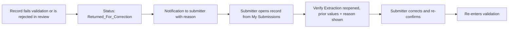
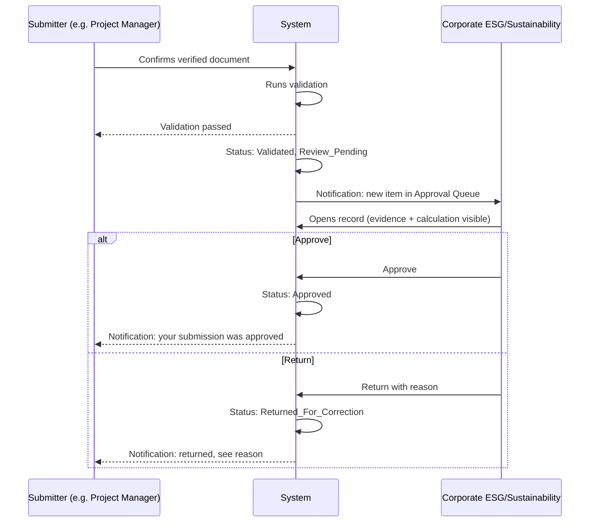
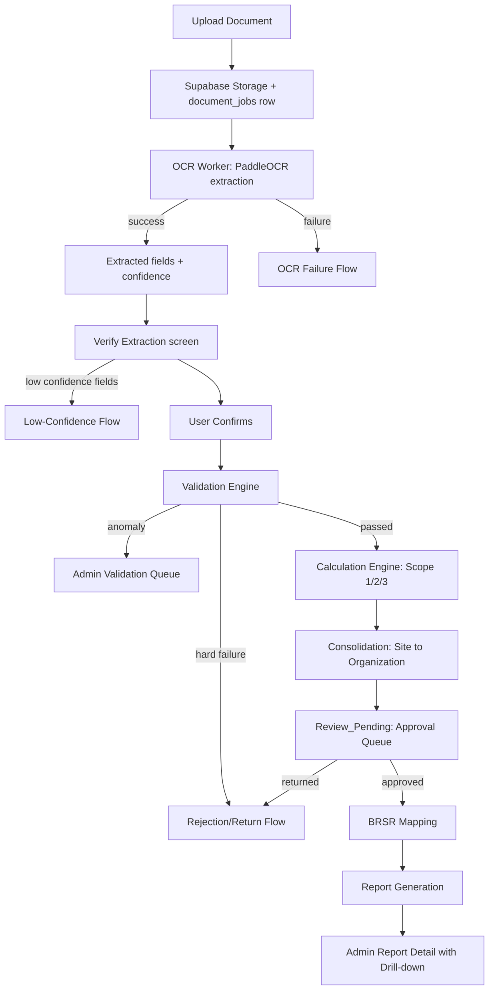

# Application Flow Document (App Flow)
## PS-08 — Evidence-First ESG/BRSR Reporting Platform (TraceESG)

**Document ID:** 03_APP_FLOW.md
**Version:** 1.0
**Status:** Draft for review
**Source of truth, in order:** `Master_Approach.md` → `01_PRD.md` → `02_TRD.md`. This document does not contradict any decision made there; it resolves the UX/navigation-level decisions those documents leave open and defines every page, journey, and state needed before frontend implementation begins.

**Full reasoning trail for the UX decisions below:** `.grill/app-flow-ux-decisions.md`.

---

## 0. UX Decisions This Document Makes (read first)

A few structural choices were resolved during scoping and shape everything below. Stating them once, up front, so the page inventory doesn't look arbitrary:

1. **OCR processing is non-blocking.** There is no full-page "watch it process" wizard step. A user uploads a document, gets an immediate confirmation, and is returned to their workspace. The document shows a `Processing` status until the OCR worker (per `02_TRD.md` §11/§23) finishes; the user is notified when it's ready for verification. This matches the async backend architecture instead of fighting it.
2. **Notifications deep-link to the specific record.** Clicking a "ready for verification" notification opens `Verify Extraction` for that exact document, not a general list.
3. **MVP upload is desktop drag-and-drop only.** Mobile/field camera capture is real future scope (noted where relevant) but not designed into these page specs.
4. **Reporting period is automatic, not manually picked.** The current open period is assumed at upload time; the period is shown as an editable, OCR-correctable field during verification. If no period is open, category selection shows a blocking empty state.
5. **Approval is a real human step**, performed by **Corporate ESG/Sustainability** (Admin can also approve) — distinct from the person who submitted and verified the record.
6. **Some requested page-inventory items are consolidated**, not dropped, where they're genuinely one CRUD surface or one filtered view rather than separate concerns (each noted explicitly at the point of consolidation, per the brief's own instruction not to pad the page count).

---

## 1. Application Model & Navigation Shell

Single Next.js application (per `02_TRD.md`), two role-gated route namespaces, resolved once at login and enforced by middleware + RLS on every request:

- **`/admin/*`** — Admin only.
- **`/app/*`** — all non-admin roles (HR, Project Manager, EHS/Environment, Finance/CSR, Procurement, Corporate ESG/Sustainability). Page *content* within `/app/*` varies by role/org-scope/permissions, but the route structure is shared.
- **Public routes** — `/login`, `/forgot-password`.

**Admin shell:** persistent left sidebar grouped as Organization · Users & Access · Reporting Periods · Submissions (Monitoring / OCR / Validation / Approval) · Data & Calculation (Factors / BRSR Mapping / Data Explorer / Scope 1 / Scope 2 / Scope 3) · Reports · Audit Trail · Settings. Top bar: organization/period context switcher, notifications bell, profile menu.

**User shell:** persistent left sidebar: Dashboard · My Organization/Project · Upload · My Submissions · Submission History. Top bar: notifications bell, profile menu. A prominent "Upload Document" call-to-action is always reachable from the dashboard, since it's the core recurring action for every non-admin role.

---

## 2. Complete Page Inventory

Each page is specified with: Route · Access role · Purpose · Entry points · Primary actions · Secondary actions · Navigation after each action · Required data · API/backend dependency · Loading state · Empty state · Error state · Success state · Permission restrictions.

### 2.1 Public

#### Login
- **Route:** `/login`
- **Access role:** Unauthenticated
- **Purpose:** Authenticate the user and route them into the correct dashboard.
- **Entry points:** Direct navigation; redirect target from any protected route when unauthenticated; redirect target after logout/session expiry.
- **Primary actions:** Submit email/password → authenticate.
- **Secondary actions:** "Forgot password?" link.
- **Navigation after action:** Success → Auth Flow (§4) resolves destination (`/admin` or `/app`). Failure → stays on `/login` with inline error.
- **Required data:** None until submit.
- **API/backend dependency:** Supabase Auth sign-in.
- **Loading state:** Button spinner on submit; form disabled.
- **Empty state:** N/A.
- **Error state:** Invalid credentials → inline field error, no account enumeration ("Invalid email or password"). Account disabled/deactivated by Admin → distinct message ("Your account has been deactivated — contact your Admin").
- **Success state:** Immediate redirect, no intermediate confirmation screen.
- **Permission restrictions:** None (public).

#### Forgot/Reset Password
- **Route:** `/forgot-password` (+ Supabase-issued reset link back into the app)
- **Access role:** Unauthenticated
- **Purpose:** Self-service password recovery via Supabase Auth's built-in flow.
- **Entry points:** Link from Login.
- **Primary actions:** Submit email → request reset link.
- **Secondary actions:** Back to Login.
- **Navigation after action:** Confirmation message shown in place (does not reveal whether the email exists); user follows emailed link to a password-reset form, then redirected to `/login`.
- **Required data:** Email address.
- **API/backend dependency:** Supabase Auth password-reset flow.
- **Loading state:** Button spinner.
- **Empty state:** N/A.
- **Error state:** Network/server error → generic retry message.
- **Success state:** "If that email exists, a reset link has been sent."
- **Permission restrictions:** None (public).

---

### 2.2 Admin

#### Admin Dashboard (Control Tower)
- **Route:** `/admin`
- **Access role:** Admin
- **Purpose:** The reporting-readiness command center from `Master_Approach.md` §33 — completion percentages, coverage, and an actionable issue panel, not decorative charts.
- **Entry points:** Post-login redirect for Admin; sidebar "Dashboard."
- **Primary actions:** Click any KPI card or issue-panel row to drill into the underlying queue/page (Submission Monitoring, Validation Queue, OCR Monitoring, Approval Queue, BRSR readiness).
- **Secondary actions:** Change organization/period context (top bar).
- **Navigation after action:** Each card/row navigates to its owning page, pre-filtered to the relevant slice (e.g., "12 low-confidence OCR records" → OCR Monitoring filtered to low-confidence).
- **Required data:** Org hierarchy, current reporting period, aggregate counts across submissions/validation/approval/BRSR coverage.
- **API/backend dependency:** Aggregate queries against `esg_records`, `document_jobs`, `validation_results`, `approvals`, `brsr_mapping` coverage view.
- **Loading state:** Skeleton KPI cards + skeleton issue list.
- **Empty state:** New organization with no data yet → "No activity yet this period" with a link to Reporting Periods / Organization Hierarchy setup.
- **Error state:** Aggregate query failure → retry banner, cards show "—" rather than stale/incorrect numbers.
- **Success state:** N/A (persistent dashboard, not a one-shot action).
- **Permission restrictions:** Admin only.

#### Organization Hierarchy
*(Consolidates the brief's "Organization Management," "Subsidiaries/Business Units," and "Projects/Sites" — these are one CRUD surface over one configurable tree per `Master_Approach.md` §5/§37, not three unrelated screens.)*
- **Route:** `/admin/organization`
- **Access role:** Admin
- **Purpose:** Create/edit the Group → Subsidiary → Business Unit → Region → Project → Site → Department hierarchy.
- **Entry points:** Sidebar "Organization"; Admin Dashboard setup prompts on empty state.
- **Primary actions:** Add node (at any level), edit node, deactivate node, assign a node's parent.
- **Secondary actions:** Search/filter tree; export hierarchy.
- **Navigation after action:** Stays on page (tree updates in place); newly created node selected/highlighted.
- **Required data:** Full hierarchy tree for the organization.
- **API/backend dependency:** CRUD against the hierarchy table(s); RLS ensures only Admin can write.
- **Loading state:** Tree skeleton.
- **Empty state:** No hierarchy yet → "Set up your organization" onboarding CTA (create first Subsidiary).
- **Error state:** Save failure (e.g., orphaned parent) → inline validation error, no partial save.
- **Success state:** Inline toast "Saved" + tree reflects change immediately.
- **Permission restrictions:** Admin only; deactivating a node with active users/projects requires confirmation (warns of downstream impact).

#### User Management
- **Route:** `/admin/users`
- **Access role:** Admin
- **Purpose:** Create/edit users, assign role + organizational scope.
- **Entry points:** Sidebar "Users."
- **Primary actions:** Invite/create user, edit role/scope, activate/deactivate.
- **Secondary actions:** Search/filter by role, org node, status.
- **Navigation after action:** Stays on list; row updates or new invite row appears (pending acceptance).
- **Required data:** User list with role + org-scope assignment(s); hierarchy tree (for scope picker).
- **API/backend dependency:** Supabase Auth user management + `user_org_scope` table writes.
- **Loading state:** Table skeleton.
- **Empty state:** No users yet beyond the Admin creating the account → "Invite your first team member."
- **Error state:** Duplicate email / invalid scope assignment → inline field error.
- **Success state:** Toast "Invitation sent" / "User updated."
- **Permission restrictions:** Admin only.

#### Roles & Permissions
- **Route:** `/admin/roles`
- **Access role:** Admin
- **Purpose:** Manage the permission set per role (PRD §10) — scalable beyond the initial fixed role list.
- **Entry points:** Sidebar "Roles & Permissions."
- **Primary actions:** Edit a role's permission set; create a new role (future-proofing per PRD's "additional roles addable without code changes").
- **Secondary actions:** View which users hold a given role.
- **Navigation after action:** Stays on page; permission matrix updates in place.
- **Required data:** Role list, permission catalogue.
- **API/backend dependency:** Roles/permissions tables.
- **Loading state:** Matrix skeleton.
- **Empty state:** N/A (system roles always pre-seeded).
- **Error state:** Attempting to remove a permission a role depends on for a still-assigned page → blocked with explanation.
- **Success state:** Toast "Permissions updated."
- **Permission restrictions:** Admin only.

#### Reporting Periods
- **Route:** `/admin/reporting-periods`
- **Access role:** Admin
- **Purpose:** Create, open, and close monthly reporting periods (PRD §31).
- **Entry points:** Sidebar "Reporting Periods."
- **Primary actions:** Create new period, open/close a period, view submission-completion % per period.
- **Secondary actions:** Set submission-window dates.
- **Navigation after action:** Stays on page; period status badge updates.
- **Required data:** Period list with status and completion stats.
- **API/backend dependency:** `reporting_periods` table.
- **Loading state:** List skeleton.
- **Empty state:** No period yet → blocking "Create your first reporting period" prompt (this is what gates every non-admin upload flow, per §0.4).
- **Error state:** Attempting to close a period with unresolved validation failures → warning, allows override with confirmation.
- **Success state:** Toast "Period opened/closed."
- **Permission restrictions:** Admin only.

#### Submission Monitoring
- **Route:** `/admin/submissions`
- **Access role:** Admin
- **Purpose:** Org-wide view of every submission and its pipeline status.
- **Entry points:** Sidebar "Submission Monitoring"; Admin Dashboard drill-in.
- **Primary actions:** Filter by org node/role/period/status; open a record's detail (which itself deep-links into evidence, calculation, and audit trail — see Journey 5).
- **Secondary actions:** Export filtered list.
- **Navigation after action:** Row click → record detail view (shared component also used by Validation Queue / Approval Queue / ESG Data Explorer).
- **Required data:** All `esg_records` for the org, joined to document/verification/validation/approval status.
- **API/backend dependency:** Filtered query against `esg_records` + joins.
- **Loading state:** Table skeleton.
- **Empty state:** No submissions this period → "No submissions yet for [period]."
- **Error state:** Query failure → retry banner.
- **Success state:** N/A (monitoring view).
- **Permission restrictions:** Admin only (Corporate ESG/Sustainability gets an analogous but scope-limited view under `/app`, see §2.3).

#### OCR Monitoring
- **Route:** `/admin/ocr-monitoring`
- **Access role:** Admin
- **Purpose:** Visibility into the OCR worker pipeline — job status, confidence distribution, failures.
- **Entry points:** Sidebar "OCR Monitoring"; Admin Dashboard "low-confidence OCR" card.
- **Primary actions:** Filter by status (Pending/Processing/Completed/Failed) or confidence band; open a job's detail; retry a failed job.
- **Secondary actions:** None.
- **Navigation after action:** Retry → job re-queued, status updates in place. Row click → underlying document/record.
- **Required data:** `document_jobs` table contents.
- **API/backend dependency:** `document_jobs` query + retry mutation.
- **Loading state:** Table skeleton.
- **Empty state:** No jobs processed yet.
- **Error state:** Worker unreachable (no recent heartbeat) → banner "OCR worker has not reported in X minutes" (operational health signal).
- **Success state:** Toast "Job re-queued."
- **Permission restrictions:** Admin only.

#### Validation Queue
- **Route:** `/admin/validation-queue`
- **Access role:** Admin
- **Purpose:** Records that failed validation or are flagged as anomalies, needing review (PRD §29).
- **Entry points:** Sidebar "Validation Queue"; Admin Dashboard card.
- **Primary actions:** Open a flagged record; mark reviewed/accepted (clears the anomaly flag with a reason) or return it to the submitter.
- **Secondary actions:** Filter by validation-failure category (format/organizational/period/evidence/logical/anomaly).
- **Navigation after action:** "Return to submitter" → Rejection/Return Flow (§4.9). "Accept anomaly" → record proceeds to calculation.
- **Required data:** Records with `validation_status = Flagged` or `Failed`.
- **API/backend dependency:** `validation_results` query + status mutation.
- **Loading state:** Table skeleton.
- **Empty state:** "No records need validation review" (a genuinely good empty state here).
- **Error state:** Mutation failure → inline retry.
- **Success state:** Toast "Reviewed" / "Returned to submitter."
- **Permission restrictions:** Admin only.

#### Approval Queue
- **Route:** `/admin/approval-queue`
- **Access role:** Admin, Corporate ESG/Sustainability
- **Purpose:** Active review queue for validated records awaiting human approval before they're report-final (§0.5).
- **Entry points:** Sidebar "Approval Queue"; notification for Corporate ESG/Sustainability users when new items arrive.
- **Primary actions:** Open a record; Approve; Return for correction (with required reason).
- **Secondary actions:** Filter by org node/period/scope.
- **Navigation after action:** Approve → Approval Flow (§4.10) completes, record moves to `Included_In_Report`-eligible state. Return → Rejection/Return Flow (§4.9).
- **Required data:** Records with `validation_status = Validated`, `approval_status = Review_Pending`.
- **API/backend dependency:** `esg_records` + `approvals` table writes; audit-log write on every decision.
- **Loading state:** Table skeleton.
- **Empty state:** "Nothing awaiting your approval."
- **Error state:** Mutation failure → inline retry, decision not silently lost.
- **Success state:** Toast "Approved" / "Returned for correction."
- **Permission restrictions:** Admin and Corporate ESG/Sustainability only; a user cannot approve their own submission (enforced server-side, not just hidden in UI).

#### Conversion Factors
- **Route:** `/admin/conversion-factors`
- **Access role:** Admin (or explicitly authorized ESG personnel per `Master_Approach.md` §25)
- **Purpose:** Manage the versioned conversion/emission factor database (PRD §20, TRD §25).
- **Entry points:** Sidebar "Conversion Factors."
- **Primary actions:** Add factor, edit factor (creates a new version, does not mutate history), deactivate a factor.
- **Secondary actions:** Filter by activity type/geography/status.
- **Navigation after action:** Stays on page; version history visible per factor.
- **Required data:** `conversion_factors` table.
- **API/backend dependency:** CRUD with versioning logic (never overwrite an effective-dated row already used in a calculation).
- **Loading state:** Table skeleton.
- **Empty state:** No factors configured yet → blocking notice that Scope 1/2/3 calculations cannot run until factors exist.
- **Error state:** Attempting to edit a factor version already referenced by a stored calculation → blocked, must create a new version instead (protects reproducibility per TRD §24).
- **Success state:** Toast "Factor saved" / "New version created."
- **Permission restrictions:** Admin (and explicitly authorized ESG personnel role, if granted).

#### BRSR Mapping
- **Route:** `/admin/brsr-mapping`
- **Access role:** Admin
- **Purpose:** Manage the ESG-metric-to-BRSR-indicator configuration layer (PRD §27, TRD §26).
- **Entry points:** Sidebar "BRSR Mapping."
- **Primary actions:** Create/edit a metric-to-indicator mapping; mark a mapping's applicability.
- **Secondary actions:** Filter by BRSR section (A/B/C) — exact section structure **[VERIFY AGAINST AUTHORITATIVE BRSR SOURCE]**.
- **Navigation after action:** Stays on page; mapping list updates.
- **Required data:** `esg_metrics`, `brsr_indicators`, `esg_metric_brsr_mapping`.
- **API/backend dependency:** CRUD against the mapping tables.
- **Loading state:** Table skeleton.
- **Empty state:** No mappings yet → blocking notice that BRSR reports cannot be generated until mappings exist.
- **Error state:** Attempting to map a metric to a non-existent indicator → inline validation error.
- **Success state:** Toast "Mapping saved."
- **Permission restrictions:** Admin only.

#### ESG Data Explorer
- **Route:** `/admin/data-explorer`
- **Access role:** Admin
- **Purpose:** Free-form querying/filtering across all ESG records — the general-purpose complement to the more purpose-built Submission Monitoring / Scope dashboards.
- **Entry points:** Sidebar "Data Explorer."
- **Primary actions:** Filter by any combination of org node/period/scope/metric/status; open any record's detail.
- **Secondary actions:** Export filtered results.
- **Navigation after action:** Row click → shared record detail component (same as Submission Monitoring).
- **Required data:** `esg_records` with full joins.
- **API/backend dependency:** Flexible filtered query.
- **Loading state:** Table skeleton.
- **Empty state:** "No records match these filters."
- **Error state:** Query timeout on an overly broad filter → suggestion to narrow filters.
- **Success state:** N/A.
- **Permission restrictions:** Admin only.

#### Scope 1 Dashboard / Scope 2 Dashboard / Scope 3 Dashboard
*(Same page template, three routes — specified once.)*
- **Route:** `/admin/scope-1`, `/admin/scope-2`, `/admin/scope-3`
- **Access role:** Admin
- **Purpose:** Scope-specific consolidated view — totals by org level, completion %, trend across periods.
- **Entry points:** Sidebar "Scope 1/2/3"; Admin Dashboard completion cards.
- **Primary actions:** Drill from a consolidated total down through org levels (Organization → Subsidiary → BU → Project → Site) to the contributing records.
- **Secondary actions:** Change period; toggle chart/table view.
- **Navigation after action:** Drill-down → next org level in place, breadcrumb trail retained (foundation for the Journey 5 drill-down pattern).
- **Required data:** Consolidated calculation totals per org level for the scope.
- **API/backend dependency:** Consolidation view/query (TRD §29) filtered by scope.
- **Loading state:** Chart/table skeleton.
- **Empty state:** No calculated data yet for this scope/period.
- **Error state:** Consolidation query failure → retry banner.
- **Success state:** N/A.
- **Permission restrictions:** Admin only. Scope 3 dashboard additionally shows which categories are configured/active vs. not-yet-enabled, per the modular Scope 3 architecture.

#### Reports
- **Route:** `/admin/reports`
- **Access role:** Admin
- **Purpose:** Generate consolidated ESG/BRSR reports.
- **Entry points:** Sidebar "Reports."
- **Primary actions:** Configure report parameters (period, org scope, format) and generate; view past report runs.
- **Secondary actions:** Re-download a previously generated report.
- **Navigation after action:** Generate → Report Generation Flow (§4.11); on completion, navigates to Report Detail (§2.2 next entry) for that run.
- **Required data:** Org hierarchy, reporting periods, BRSR mapping completeness.
- **API/backend dependency:** Report-generation job (headless-Chromium PDF render per TRD §17) + `report_runs` table.
- **Loading state:** "Generating report..." with progress indicator, non-blocking (user can navigate away and be notified — same async pattern as OCR).
- **Empty state:** No reports generated yet.
- **Error state:** Report Generation Failure Flow (§4.11).
- **Success state:** Toast + notification "Report ready," navigable to Report Detail.
- **Permission restrictions:** Admin only.

#### Report Detail / Drill-down
- **Route:** `/admin/reports/[reportId]`
- **Access role:** Admin
- **Purpose:** View a specific generated report and drill down from any reported value to its supporting evidence — the platform's signature capability (`Master_Approach.md` §32, PRD §39).
- **Entry points:** From Reports list; from a completed-report notification.
- **Primary actions:** Click any reported value → drill-down (Journey 5); download report file.
- **Secondary actions:** Compare against a prior period's report.
- **Navigation after action:** Drill-down click → in-page expansion or side panel showing BRSR indicator → ESG metric → calculation → verified activity data → original document, without leaving the report context.
- **Required data:** The specific report's stored output + live links to its underlying records (not just a static rendered file — the drill-down needs the data trail, not just the PDF).
- **API/backend dependency:** `report_runs` record + traceability query joining calculation → verification → document.
- **Loading state:** Report-content skeleton.
- **Empty state:** N/A (only reachable for an existing report).
- **Error state:** Underlying record deleted/inaccessible (should not normally happen given retention policy in TRD §30) → explicit "source record unavailable" rather than a silent broken link.
- **Success state:** N/A (viewing page).
- **Permission restrictions:** Admin only.

#### Audit Trail
- **Route:** `/admin/audit-trail`
- **Access role:** Admin
- **Purpose:** Query the append-only audit log (PRD §28, TRD §27).
- **Entry points:** Sidebar "Audit Trail"; "View audit history" link from any record detail view.
- **Primary actions:** Filter by user/record/action/date range; view an event's before/after values.
- **Secondary actions:** Export filtered audit log.
- **Navigation after action:** Stays on page; event detail expands in place.
- **Required data:** `audit_log` table.
- **API/backend dependency:** Filtered, paginated audit-log query.
- **Loading state:** Table skeleton.
- **Empty state:** No events match filters.
- **Error state:** Query failure → retry banner.
- **Success state:** N/A.
- **Permission restrictions:** Admin only; log itself is never editable from the UI (append-only, enforced at the DB layer).

#### Settings
- **Route:** `/admin/settings`
- **Access role:** Admin
- **Purpose:** Platform-level configuration not covered by a dedicated page (org profile, retention policy, confidence thresholds).
- **Entry points:** Sidebar "Settings."
- **Primary actions:** Edit OCR confidence threshold, document retention policy, notification preferences at the org level.
- **Secondary actions:** None.
- **Navigation after action:** Stays on page.
- **Required data:** Org-level settings record.
- **API/backend dependency:** `org_settings` table.
- **Loading state:** Form skeleton.
- **Error state:** Invalid value (e.g., threshold outside 0-100%) → inline validation.
- **Success state:** Toast "Settings saved."
- **Permission restrictions:** Admin only.

---

### 2.3 Non-Admin User (`/app/*`)

#### User Dashboard
- **Route:** `/app`
- **Access role:** HR, Project Manager, EHS/Environment, Finance/CSR, Procurement, Corporate ESG/Sustainability
- **Purpose:** Role-scoped landing page — what's pending, what's mine, what needs my attention.
- **Entry points:** Post-login redirect for non-admin roles; sidebar "Dashboard."
- **Primary actions:** "Upload Document" CTA; click a pending-task card (e.g., "3 documents need verification") to jump into that work.
- **Secondary actions:** Switch organization/project context if the user has more than one assignment.
- **Navigation after action:** Upload CTA → Upload Document. Task card → My Submissions, pre-filtered. **Corporate ESG/Sustainability** additionally sees a cross-project monitoring summary here (read/review scope, not full Admin monitoring).
- **Required data:** User's role, assigned org scope(s), current reporting period, pending-task counts.
- **API/backend dependency:** Scoped query against `esg_records`/`document_jobs`, filtered by RLS to the user's assignments.
- **Loading state:** Skeleton cards.
- **Empty state:** **No projects assigned** → explicit "You haven't been assigned to a project yet — contact your Admin" (one of the required error/empty states).
- **Error state:** Query failure → retry banner.
- **Success state:** N/A.
- **Permission restrictions:** RLS-scoped to the user's assigned org nodes only.

#### My Organization/Project
- **Route:** `/app/my-scope`
- **Access role:** All non-admin roles
- **Purpose:** Read-only view of the user's assigned organizational scope (which subsidiary/BU/project/site/department they can act on).
- **Entry points:** Sidebar "My Organization/Project."
- **Primary actions:** None (informational); link into My Submissions filtered to a specific assigned node.
- **Secondary actions:** None.
- **Navigation after action:** N/A.
- **Required data:** `user_org_scope` rows for the current user.
- **API/backend dependency:** Scoped query.
- **Loading state:** List skeleton.
- **Empty state:** No assignment — same "contact your Admin" state as the dashboard.
- **Error state:** Query failure → retry banner.
- **Success state:** N/A.
- **Permission restrictions:** User sees only their own assignments.

#### Upload Document
- **Route:** `/app/upload`
- **Access role:** All non-admin roles (category options shown vary by role, per PRD §10 role-to-category mapping — e.g., Project Manager sees Scope 1/2/3 categories, EHS sees water/waste/air/safety, HR sees workforce categories)
- **Purpose:** The core recurring action of the platform — select category, drag-and-drop the supporting document.
- **Entry points:** Dashboard CTA; sidebar "Upload."
- **Primary actions:** Select ESG activity/category → drag-and-drop (or file-picker) a document → submit.
- **Secondary actions:** None (deliberately minimal — this is the one-action-per-visit screen the PRD's "no manual form filling" principle is built around).
- **Navigation after action:** Submit succeeds → toast "Document received, processing" → user returned to Dashboard or My Submissions (not a wait screen, per §0.1). User may immediately upload another document.
- **Required data:** Category list scoped to the user's role; current open reporting period (auto-assumed, per §0.4); the file itself.
- **API/backend dependency:** File → Supabase Storage; `esg_records` + `document_jobs` row creation.
- **Loading state:** Upload-progress bar during file transfer (this is a real, brief, honest loading state — distinct from OCR processing, which happens after).
- **Empty state:** **No open reporting period** → blocking notice before category selection is even shown, per §0.4 ("No active reporting period — contact your Admin"). **No categories assigned to this role/scope** → "No ESG categories are configured for your role yet — contact your Admin."
- **Error state:** **Invalid file type** (inline, before upload starts) — **missing document** (submit blocked until a file is attached) — **network failure during upload** (retry option, file not silently lost) — **duplicate document detected** (same file hash/invoice number already exists for this project+period+metric — flagged as a warning the user must acknowledge before proceeding, per `Master_Approach.md` §41: flagged for review, not silently blocked).
- **Success state:** Toast + immediate return to workspace (§0.1).
- **Permission restrictions:** Category list is role- and scope-filtered; a user cannot upload against a project/category outside their assignment (enforced by RLS, not just hidden in the picker).

#### Verify Extraction
- **Route:** `/app/verify/[documentId]`
- **Access role:** The user who submitted the document (or any role with permission over that org scope)
- **Purpose:** The core evidence-verification screen — show the original document and the OCR-extracted fields side by side, let the user confirm or correct.
- **Entry points:** Notification deep-link (§0.2); row click from My Submissions "Needs Verification."
- **Primary actions:** Review each extracted field against the document; edit an incorrect value; **Confirm**; **Reject** (document is not usable evidence — discards the record with a reason, does not silently disappear).
- **Secondary actions:** Zoom/pan the source document image; view OCR confidence score per field.
- **Navigation after action:** Confirm → Validation runs automatically → user returned to My Submissions, record now shows `Validated` or `Flagged`/`Returned` status. Reject → record marked `Rejected`, removed from active work, visible in Submission History.
- **Required data:** Document file (from Storage, via signed URL), OCR-extracted fields + confidence scores, editable reporting period (§0.4).
- **API/backend dependency:** `documents`, `ocr_extractions`, `ocr_fields` read; `verifications` write on confirm.
- **Loading state:** Document + field skeleton while fetching.
- **Empty state:** N/A (only reachable for a document that has completed OCR).
- **Error state:** **OCR failure** (job failed — see OCR Failure Flow §4.5, shown here as "Extraction failed — you can still enter this manually as an exception" *[flagged: manual fallback entry is an exception path, not the normal workflow, and should require Admin-visible justification]*) — **low OCR confidence** (fields below threshold are visually flagged and block Confirm until explicitly reviewed, per §4.6) — **missing extracted fields** (required field wasn't found — shown as an empty, user-fillable field, clearly marked as not-from-OCR) — **document unreadable** (corrupted/blank file — same fallback as OCR failure).
- **Success state:** Toast "Verified — validation in progress."
- **Permission restrictions:** Only the submitter or an authorized reviewer within the same org scope; cannot verify a document outside one's assignment.

#### My Submissions
*(Consolidates the brief's "Submission Status," "Returned Records," and "Approved Records" as filter tabs on one page — these are the same record set at different pipeline stages, not different data.)*
- **Route:** `/app/submissions`
- **Access role:** All non-admin roles
- **Purpose:** The active-work triage view — everything the user has submitted, at whatever stage it's at.
- **Entry points:** Sidebar "My Submissions"; Dashboard task cards; notifications.
- **Primary actions:** Filter by status tab (Processing · Needs Verification · Validated · Pending Approval · Returned · Approved · Rejected); open a record.
- **Secondary actions:** Re-submit a returned record (jumps into Verify Extraction with the correction context).
- **Navigation after action:** Row click → Verify Extraction (if actionable) or a read-only record detail (if past that stage).
- **Required data:** All `esg_records` submitted by this user (or within their org scope, per role).
- **API/backend dependency:** Scoped, filtered query.
- **Loading state:** Table skeleton.
- **Empty state:** **No data** — "You haven't submitted anything yet this period" with an Upload CTA.
- **Error state:** Query failure → retry banner.
- **Success state:** N/A (persistent view).
- **Permission restrictions:** RLS-scoped to the user's own submissions / org scope.

#### Submission History
- **Route:** `/app/submissions/history`
- **Access role:** All non-admin roles
- **Purpose:** Full chronological archive across all past reporting periods (distinct purpose from My Submissions: audit-style browsing, not active triage).
- **Entry points:** Sidebar "Submission History."
- **Primary actions:** Filter by period/status/category; open a past record (read-only).
- **Secondary actions:** Export.
- **Navigation after action:** Row click → read-only record detail with full evidence trail.
- **Required data:** Historical `esg_records` for the user's scope, across periods.
- **API/backend dependency:** Scoped, paginated historical query.
- **Loading state:** Table skeleton.
- **Empty state:** **No reporting data** — "No submission history yet."
- **Error state:** Query failure → retry banner.
- **Success state:** N/A.
- **Permission restrictions:** Same scoping as My Submissions.

#### Notifications
- **Route:** `/app/notifications`
- **Access role:** All non-admin roles (Admin has an equivalent via the top-bar bell, not a separate full-page inventory item)
- **Purpose:** Full list of notifications (the bell dropdown shows recent/unread; this page is the complete, filterable history).
- **Entry points:** Top-bar bell "View all."
- **Primary actions:** Click a notification → deep-link to its target (§0.2); mark all read.
- **Secondary actions:** Filter by type (verification needed, returned, approved, low confidence, deadline).
- **Navigation after action:** Deep-link per notification type (verification → Verify Extraction; returned → My Submissions; approval decision → My Submissions).
- **Required data:** `notifications` table rows for this user.
- **API/backend dependency:** Scoped query + read-state mutation.
- **Loading state:** List skeleton.
- **Empty state:** "No notifications yet."
- **Error state:** Query failure → retry banner.
- **Success state:** N/A.
- **Permission restrictions:** User sees only their own notifications.

#### Profile
- **Route:** `/app/profile`
- **Access role:** All authenticated users
- **Purpose:** View own account details, role, and org-scope assignment (read-only for the assignment; users cannot self-elevate); change password.
- **Entry points:** Top-bar profile menu.
- **Primary actions:** Update display name; change password.
- **Secondary actions:** Logout (also available directly from the profile menu without opening this page).
- **Navigation after action:** Stays on page.
- **Required data:** Current user record.
- **API/backend dependency:** Supabase Auth profile update.
- **Loading state:** Form skeleton.
- **Error state:** Password-change validation failure → inline error.
- **Success state:** Toast "Profile updated."
- **Permission restrictions:** Users can only edit their own profile; role/org-scope fields are visible but not editable (Admin-only, per §2.2 User Management).

---

## 3. Global States (apply across pages, not repeated per-page above)

- **Unauthorized access:** any request to a route outside the user's role/scope → redirected to their own dashboard with a toast ("You don't have access to that page"), never a raw 403 page with no way forward. See Unauthorized Access Flow (§4.4).
- **Expired session:** any API call returning an auth error → user redirected to `/login` with a "Your session expired — please log in again" message, and (where feasible) returned to the page they were on after re-authenticating. See Session Expiration Flow (§4.3).
- **Network failure / server error:** any page's data-fetch failure surfaces a retry affordance in place, never a full white-screen crash — consistent with the per-page "Error state" entries above.
- **No projects assigned:** covered per-page above (Dashboard, My Organization/Project) — always an explicit, actionable message, never a blank screen.

---

## 4. Flows

### 4.1 Auth Flow

1. User submits email/password on `/login`.
2. Supabase Auth verifies credentials; on failure, inline error, user stays on `/login`.
3. On success, the app resolves the user's role and `user_org_scope` assignment(s).
4. Admin → redirect to `/admin`. Non-admin with at least one assignment → redirect to `/app`. Non-admin with no assignment → land on `/app` showing the "no projects assigned" empty state, not an error — the account exists and is valid, it's just unconfigured.

### 4.2 Logout Flow

1. User selects "Logout" from the profile menu (available on every authenticated page).
2. Supabase Auth session is invalidated client- and server-side.
3. Redirect to `/login`; any in-flight uploads or unsaved edits are not silently lost — if a verification edit is in progress, a confirm-before-leaving prompt appears first.

### 4.3 Session Expiration Flow

1. Any authenticated API call fails with an auth/token-expired error.
2. The app intercepts this centrally (not per-page ad hoc handling) and redirects to `/login` with a "session expired" message.
3. On successful re-login, the user is returned to the page they were last on where feasible (e.g., back to `Verify Extraction` for the same document), rather than dropped back to the dashboard.

### 4.4 Unauthorized Access Flow

1. User navigates (directly via URL, or a stale link) to a route outside their role or organizational scope.
2. Server-side (RLS + route guard) rejects the request before any data is returned — this is not a client-side-only check.
3. User is redirected to their own dashboard (`/admin` or `/app`) with a toast: "You don't have access to that page."
4. No information about the existence/contents of the unauthorized resource is leaked in the redirect or error message.

### 4.5 OCR Failure Flow

1. The OCR worker (TRD §23) fails to process a document (corrupted file, unsupported format, model error).
2. `document_jobs` row marked `Failed` with a reason; the document's status becomes `Incomplete`.
3. User is notified ("We couldn't process [document] — please check the file or contact support").
4. On opening the document (via notification or My Submissions), the Verify Extraction screen shows an explicit failure state, not empty extracted fields pretending to be real: "Extraction failed. You can re-upload a clearer copy, or enter values manually as a flagged exception." A manual-entry exception is recorded distinctly (flagged for Admin visibility) — it is not the normal workflow, and it does not silently look identical to an OCR-verified record in downstream reports/audit views.
5. User can re-upload a replacement document (new upload, linked to the same category/period) rather than being stuck.

### 4.6 Low-Confidence OCR Flow

1. OCR completes successfully, but one or more fields fall below the configured confidence threshold (TRD §23, Admin-configurable in Settings).
2. On Verify Extraction, those specific fields are visually flagged (e.g., amber highlight + confidence % shown).
3. The **Confirm** action is disabled until every flagged field has been explicitly touched (either edited, or explicitly acknowledged as correct) — the user cannot blindly confirm past a low-confidence field.
4. Once resolved, Confirm proceeds normally into validation.

### 4.7 Validation Failure Flow

1. After verification, the validation engine (TRD §16/§29) runs automatically.
2. **Hard failures** (format/organizational/period/evidence/logical) → record marked `Validation_Failed`, returned to the submitter's My Submissions as `Returned`, with the specific failure reason shown — this feeds directly into the Rejection/Return Flow (§4.9).
3. **Anomaly flags** (historical/statistical) → record marked `Flagged_For_Review`, routed to the Admin Validation Queue rather than auto-returned to the submitter — an anomaly may be a legitimate operational change, not necessarily an error (per `Master_Approach.md` §23), so it goes to a human reviewer rather than bouncing back automatically.

### 4.8 Rejection/Return Flow

1. A record is returned — either by the validation engine (hard failure) or by a human reviewer (Validation Queue / Approval Queue "Return for correction").
2. Status becomes `Returned_For_Correction`; the submitter is notified with the specific reason (never a bare "rejected").
3. Submitter opens the record (notification deep-link or My Submissions → Returned tab) — this reopens Verify Extraction with prior values visible and the return reason displayed prominently.
4. Submitter corrects the relevant field(s) and re-confirms.
5. Record re-enters validation from the top — it does not skip straight back to "Validated" just because a human touched it.

### 4.9 Approval Flow

1. A record passes validation and enters `Review_Pending` — appearing in the Approval Queue.
2. Corporate ESG/Sustainability (or Admin) is notified and opens the record, which shows the full evidence trail (original document, extracted/verified values, calculation trace) so the decision isn't made blind.
3. **Approve** → status becomes `Approved`, eligible for inclusion in the next generated report; submitter is notified.
4. **Return** (with a required reason) → Rejection/Return Flow (§4.8).
5. The system enforces that the approver is not the original submitter/verifier of the same record.

### 4.10 Report Generation Flow

1. Admin configures report parameters (period, org scope) on `/admin/reports` and triggers generation.
2. Generation runs as an async job (consistent with the platform's async-by-default pattern) — Admin is not forced to wait on a blocking screen; a "Generating..." status shows and Admin can navigate away.
3. **Success:** Admin is notified "Report ready," navigates to Report Detail (§2.2), can view/download and drill down into any value.
4. **Failure** (e.g., missing BRSR mappings for required indicators, rendering error): Admin is notified with a specific reason — "Report generation failed: 4 required BRSR indicators have no metric mapping" — not a generic failure message, since this is exactly the kind of gap the platform should surface clearly rather than produce an incomplete report silently.
5. Every generated report run is retained and listed, whether successful or failed, for traceability of what was attempted and when.

### 4.11 Evidence-to-BRSR Pipeline (overall reference diagram)

---

## 5. Core User Journeys

### Journey 1 — Project Manager uploads a diesel invoice and obtains a Scope 1 calculation

1. PM logs in → redirected to `/app` (Auth Flow §4.1).
2. Dashboard shows the current reporting period and an "Upload Document" CTA.
3. PM clicks Upload → `/app/upload`.
4. PM selects category "Diesel Purchase" (Scope 1) from the role-scoped category list.
5. PM drags-and-drops `diesel_invoice_aug.pdf`.
6. File uploads (progress bar); on completion, toast "Document received, processing" — PM is returned to the dashboard, free to do something else.
7. In the background: file lands in Supabase Storage, a `document_jobs` row is created (`Pending`), the OCR worker picks it up, PaddleOCR extracts fuel type, quantity, unit, invoice number, date.
8. PM receives a notification: "Diesel invoice ready for verification."
9. PM clicks the notification → deep-link to `/app/verify/[documentId]`.
10. Verify Extraction shows the original PDF alongside extracted fields: Fuel type = Diesel, Quantity = 2,500, Unit = L, with per-field confidence scores.
11. All fields are above the confidence threshold — no fields are blocked from confirmation.
12. PM reviews, confirms the reporting period (auto-assigned, editable per §0.4), clicks **Confirm**.
13. Validation engine runs: format check (numeric quantity, valid unit), organizational check (project matches PM's assignment), period check, evidence check — all pass.
14. Calculation engine runs: unit normalization (already in litres, no conversion needed), selects the applicable, version-effective diesel emission factor, computes Scope 1 CO2e, stores the full calculation trace (TRD §24).
15. Record status becomes `Validated`, `Review_Pending` — enters the Approval Queue.
16. PM sees the record in My Submissions under "Pending Approval," with the calculated result visible (read-only) even before approval, so the PM isn't left guessing.
17. (Continued in Journey 4/5 from the Admin/Corporate ESG side.)

### Journey 2 — Project Manager uploads an electricity bill and obtains a Scope 2 calculation

1–9. Same pattern as Journey 1 steps 1–9, category = "Grid Electricity" (Scope 2), document = `electricity_bill_aug.pdf`.
10. Verify Extraction shows extracted fields: Consumption = 102,430, Unit = kWh, Billing Period = 01–31 Aug 2026, Source classification = Grid (per `Master_Approach.md` §16 example).
11. PM confirms; validation passes.
12. Calculation engine selects the applicable electricity emission factor (distinguishing grid vs. renewable, since the source evidence supports that classification), computes Scope 2 CO2e.
13. Record enters `Review_Pending`, same downstream path as Journey 1.

### Journey 3 — HR uploads workforce evidence and verifies extracted information

1. HR user logs in → `/app`.
2. Dashboard shows HR-relevant pending tasks.
3. HR clicks Upload → selects category "Employee Headcount" (or the specific HR indicator category configured, e.g. gender distribution).
4. HR drags-and-drops a workforce records document (e.g., an HR system export or certified headcount statement).
5. Upload confirmed, HR returns to dashboard; OCR worker processes in the background.
6. HR is notified once extraction completes.
7. HR opens Verify Extraction: sees extracted counts (e.g., Permanent Employees, Gender Distribution fields).
8. One field (say, "Other Workers" count) is below the confidence threshold and visually flagged, per §4.6 — Confirm is disabled until HR reviews it.
9. HR checks the source document, confirms the flagged value is correct (or corrects it), then clicks Confirm.
10. Validation runs; passes.
11. Calculation engine derives the relevant BRSR HR percentage/metric (e.g., gender ratio) from the verified counts — HR never manually calculates this (per `Master_Approach.md` §18).
12. Record enters `Review_Pending`.

### Journey 4 — Admin monitors project submissions and generates a consolidated BRSR/ESG report

1. Admin logs in → `/admin` Control Tower.
2. Dashboard shows org-wide completion %, evidence coverage, and an issue panel (e.g., "5 pending approvals," "2 low-confidence OCR records").
3. Admin clicks "Pending Approvals" → `/admin/approval-queue` (or, since approval is scoped to Corporate ESG/Sustainability + Admin, Admin can act here directly if needed).
4. Admin (or Corporate ESG/Sustainability, per §4.9) reviews and approves the PM's diesel and electricity submissions from Journeys 1–2, and HR's workforce submission from Journey 3.
5. Admin navigates to `/admin/reports`, selects the current reporting period and the relevant org scope (e.g., "Subsidiary A, all projects").
6. Admin clicks "Generate Report."
7. Report generation runs asynchronously (§4.10); Admin continues monitoring other work.
8. Admin is notified "Report ready" and opens `/admin/reports/[reportId]`.
9. Report shows consolidated Scope 1, Scope 2, and BRSR HR figures, rolled up from Site → Project → Business Unit → Subsidiary → Organization.

### Journey 5 — Admin drills down from a reported value to the original supporting document

*(The signature demo, per `Master_Approach.md` §45.)*

1. Admin is viewing the generated report at `/admin/reports/[reportId]` (continuing from Journey 4).
2. Admin clicks the reported "Scope 1 Total: X tCO2e" figure for Subsidiary A.
3. Drill-down panel opens showing the BRSR indicator this figure maps to.
4. Admin expands the indicator → sees the contributing ESG metric ("Diesel Consumption").
5. Admin expands further → sees the calculation trace: input value, normalized value, factor ID + version, formula, output.
6. Admin expands further → sees the verified activity data: 2,500 L, verified by the PM, with timestamp.
7. Admin expands to the final level → the original uploaded document, `diesel_invoice_aug.pdf`, rendered inline (via signed URL from Supabase Storage) — the exact bill the PM uploaded in Journey 1, step 5.
8. At every level, Admin can also jump sideways into the Audit Trail for that specific record to see every edit/status change along the way.
9. This full chain — **Report Value → BRSR Indicator → ESG Metric → Calculation → Verified Activity Data → Original Document** — is reachable without leaving the report view, in a bounded number of clicks, exactly as required by PRD §39's acceptance criteria for consolidation & reporting.

---

*End of 03_APP_FLOW.md. See `.grill/app-flow-ux-decisions.md` for the reasoning behind the async-OCR UX, page consolidations, and approval-ownership decisions made here. Next in the document set per `Master_Approach.md` §49: database design document and API specification, both of which should treat the page/route inventory and journeys here as the frontend contract they need to support.*
