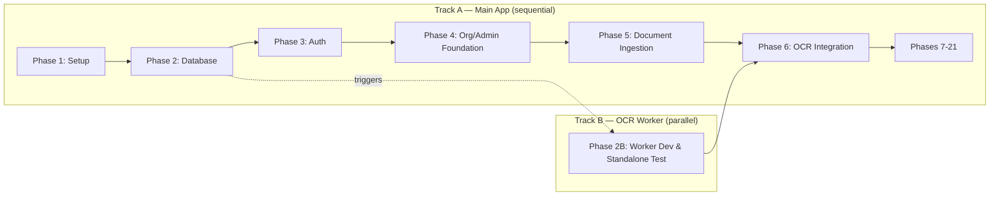

# Implementation Plan
## PS-08 — Evidence-First ESG/BRSR Reporting Platform (TraceESG)

**Document ID:** 06_IMPLEMENTATION_PLAN.md
**Version:** 1.0
**Status:** Draft for review — build-ready
**Source of truth, in order:** `Master_Approach.md` → `01_PRD.md` → `02_TRD.md` → `03_APP_FLOW.md` → `04_UI_UX_DESIGN_BRIEF.md` → `05_BACKEND_SCHEMA.md`. This document sequences their implementation; it introduces no new product, technical, UX, or data-model decisions of its own.

**Full reasoning trail for the structural decisions below:** `.grill/implementation-plan-decisions.md`.

---

## 0. AI Coding Agent Rules

These rules govern every phase in this document. Violating any of them is a defect, not a stylistic preference.

1. **Read all six project documents before modifying code.** `Master_Approach.md`, `01_PRD.md`, `02_TRD.md`, `03_APP_FLOW.md`, `04_UI_UX_DESIGN_BRIEF.md`, `05_BACKEND_SCHEMA.md`.
2. **Treat them as source of truth.** When this plan and a source document appear to conflict, the source document wins — flag the discrepancy rather than silently resolving it.
3. **Do not invent requirements.** If a phase seems to need a decision the source documents don't cover, stop and surface the gap rather than guessing.
4. **Do not change database schema without documenting the change** — any deviation from `05_BACKEND_SCHEMA.md` must be written down (what, why) at the point it's made, not left implicit in a migration file.
5. **Do not hard-code conversion factors.** They live in `conversion_factors`/`conversion_factor_versions` (schema §10), never in application code or frontend constants.
6. **Do not hard-code BRSR indicators throughout the UI.** They live in `brsr_sections`/`brsr_indicators`/`brsr_metric_mappings` (schema §11); the UI renders from that configuration, never from hard-coded question text.
7. **Do not reintroduce manual ESG forms.** The only user data-submission mechanism is document upload → OCR → verify. No phase may add a generic "enter your ESG data" form.
8. **Do not bypass OCR verification.** No code path may write to `esg_records.activity_value_verified` without a corresponding `verifications` row and human-confirmed `ocr_fields`.
9. **Do not make AI-generated calculations authoritative.** The calculation engine (Phase 9) is deterministic TypeScript logic against versioned data — never an LLM call, never a "best guess."
10. **Preserve evidence lineage.** Every phase that touches `esg_records`, `calculations`, or `documents` must keep the `Document → OCR → Verification → Validation → Calculation → BRSR → Report` chain intact and traceable end-to-end.
11. **Follow role-based authorization.** Every new table/endpoint/page must respect the RLS policies and org-scoping model in schema §16 — no phase may add a "quick access" bypass, even temporarily.
12. **Complete each phase's Definition of Done before moving forward.** A phase is not "close enough" — it's done or it isn't.
13. **Keep the application runnable after each major phase.** No phase may leave the app in a broken/non-buildable state at its end.
14. **Do not replace working architecture without justification.** If a later phase reveals an earlier decision was wrong, document why before changing it — don't silently rewrite.
15. **Store every file — source code, migrations, uploaded evidence, generated reports — in an organized location with a name that unambiguously identifies what it is**, per §1.1 below. No phase may dump a file at the repo root, invent an ad hoc storage path outside the conventions already fixed by `05_BACKEND_SCHEMA.md` §15, or check in a generated artifact next to source code.

---

## 1. How This Plan Is Structured

Two tracks, not one linear sequence, because a strict dependency check (see grill log) showed the OCR worker genuinely does not depend on auth, org/admin, or upload-UI being finished — only on the database schema existing:

- **Track A — Main Application** (Next.js/TypeScript, per `02_TRD.md` §4-§5): strictly sequential, Phases 1 → 2 → 3 → 4 → 5 → 6 → ... Each phase in this track really does depend on the one before it.
- **Track B — OCR Worker** (Python/PaddleOCR, per `02_TRD.md` §10): branches off after Phase 2 (schema), developed and tested independently against a manually-seeded `ocr_jobs` row and a file dropped directly into Supabase Storage — no login, no org data, no upload UI required. Converges back into Track A at **Phase 6**, which becomes an *integration* phase (wire an already-working worker to an already-working upload flow) rather than a build-from-scratch phase.

Both tracks build against the same shared contract: `05_BACKEND_SCHEMA.md`. Neither track may deviate from it without following Rule 4.

### 1.1 File & Folder Organization

Every file created by any phase falls into one of four categories, each with a fixed convention — no phase may invent a new pattern:

| File type | Location | Naming convention | Source |
|---|---|---|---|
| **Application source code** (`apps/web`) | `apps/web/app/<route>/*`, `apps/web/components/<domain>/*`, `apps/web/lib/<domain>/*` — mirrors the route/domain structure, never a flat `utils.ts`-style dumping ground | Files: kebab-case (`ocr-verification-screen.tsx`). Components/types: PascalCase. Variables/functions: camelCase. | `02_TRD.md` §31-§32 |
| **OCR worker source code** (`apps/ocr-worker`) | `apps/ocr-worker/<module>/*` (e.g. `extraction/`, `tests/`) | `snake_case.py`, PEP 8 throughout | `02_TRD.md` §32 |
| **Database migrations** | `supabase/migrations/` | `NNNN_description.sql` — four-digit zero-padded sequence number + short snake_case description (e.g. `0007_add_esg_records.sql`), applied strictly in numeric order | Phase 2 |
| **Uploaded evidence documents** | Supabase Storage, `evidence/{org_unit_id}/{reporting_period_id}/{document_id}/original.{ext}` | `document_id` (UUID) as the leaf directory — collision-proof; original filename preserved in `documents.file_name`, never encoded into the path itself | `05_BACKEND_SCHEMA.md` §15 |
| **Generated reports** *(convention newly fixed here — not previously specified in any prior document)* | Supabase Storage, `reports/{org_unit_id}/{reporting_period_id}/{report_run_id}/report.pdf` | Mirrors the evidence bucket's structure for consistency; `report_run_id` (UUID) as the leaf directory, path stored in `report_runs.storage_path` | This document, Phase 17 |
| **Test artifacts / QA records** | `apps/web/tests/*`, `apps/ocr-worker/tests/*`, `QA_CHECKLIST.md` at repo root | Test files mirror the source file they test (`<name>.test.ts` next to or under a parallel `tests/` tree); `QA_CHECKLIST.md` is the one exception allowed at repo root, since it's a project-level record, not source code | Phase 20 |

Nothing is ever named generically (`data.json`, `file1.pdf`, `temp.ts`) — every filename or storage path must be traceable back to what it represents without opening it.

---

## 2. Phase-by-Phase Plan

### Phase 1 — Project Setup

**Objective:** A running, empty, correctly-configured monorepo both tracks can build on.

**Why here:** Nothing else can start without a repository, dependency manager, and environment convention.

**Dependencies:** None.

**Tasks / Subtasks:**
- Initialize monorepo with pnpm workspaces per `02_TRD.md` §31: `/apps/web` (Next.js), `/apps/ocr-worker` (Python), `/packages/shared-types`, `/supabase/migrations`.
- `apps/web`: Next.js (App Router) + TypeScript + Tailwind + shadcn/ui init (per `04_UI_UX_DESIGN_BRIEF.md` §0.1) — install and configure the three-theme CSS variable structure from UI brief §6 as empty/placeholder tokens (populated for real in Phase 19, but the *mechanism* — `data-theme` attribute switching — is wired now so no later phase has to retrofit it).
- `apps/ocr-worker`: Python project scaffold (Poetry or `venv` + `requirements.txt`), PaddleOCR + PaddlePaddle dependencies pinned.
- Linting/formatting: ESLint + Prettier (`apps/web`), Ruff (`apps/ocr-worker`).
- `.env.example` files in both apps listing every variable name from `02_TRD.md` §33 (names only, no values, per that document's own rule).
- GitHub Actions: lint/typecheck on PR for both apps (per `02_TRD.md` §37) — no deploy step yet, nothing to deploy.
- `README.md` with setup instructions for both apps.

**Files/modules created:** `pnpm-workspace.yaml`, `apps/web/*` (Next.js scaffold), `apps/ocr-worker/*` (Python scaffold), `.github/workflows/ci.yml`, `.env.example` (×2).

**Database changes:** None.
**API/backend changes:** None.
**Frontend changes:** Empty Next.js app renders a placeholder page.
**Integration points:** None yet.

**Test requirements:** CI pipeline itself runs and passes on an empty scaffold (lint + typecheck green).

**Security considerations:** `.env*` (non-example) files gitignored from the start — this is the easiest point in the project to get secret-handling hygiene right, and the hardest to retrofit later.

**AI/OCR considerations:** None yet.

**Definition of Done:** `pnpm install` succeeds at the repo root; `apps/web` runs (`pnpm dev`) and renders a page; `apps/ocr-worker`'s Python environment installs cleanly; CI is green on a trivial commit.

**Deliverables:** Empty, buildable, lint-clean monorepo.

**Must NOT start before this phase is complete:** Everything else.

---

### Phase 2 — Database

**Objective:** The full schema from `05_BACKEND_SCHEMA.md` exists, migrated, indexed, constrained, RLS-enabled, and seeded with reference data.

**Why here:** Every other phase — in both tracks — reads or writes this schema. It must be exactly right before anything is built on top of it, since schema changes after real data exists are expensive (per `05_BACKEND_SCHEMA.md` §1's immutability/append-only design).

**Dependencies:** Phase 1 (Supabase project provisioned, `supabase/migrations` directory exists).

**Tasks / Subtasks:**
- Provision the Supabase project (India-region per `02_TRD.md` §12).
- Write migrations for every table in schema §3-§14, in FK-dependency order: `roles` → `permissions` → `role_permissions` → `org_units` → `users` → `user_org_assignments` → `reporting_periods` → `esg_categories` → `scopes` → `esg_metrics` → `metric_field_requirements` → `document_types` → `document_type_metric_mappings` → `validation_rules` → `calculation_formulas` → `conversion_factors` → `conversion_factor_versions` → `documents` → `ocr_jobs` → `ocr_extractions` → `ocr_fields` → `esg_records` → `esg_record_documents` → `verifications` → `validation_results` → `approvals` → `calculations` → `calculation_inputs` → `brsr_sections` → `brsr_indicators` → `brsr_metric_mappings` → `audit_logs` → `report_runs` → `notifications` → `org_settings`.
- Every table gets exactly the columns/types/constraints/indexes specified in `05_BACKEND_SCHEMA.md` — no additions, no omissions (Rule 4 applies from this phase onward).
- Implement the `set_updated_at` trigger (schema §19.1) and attach to every mutable table.
- Implement the `prevent_referenced_factor_version_mutation` trigger (schema §19.3).
- Implement `is_admin()` and `my_org_unit_ids()` helper functions (schema §16.2).
- Enable RLS on every table; implement every policy from schema §16.3, applying the same `is_admin() or org_unit_id in (select my_org_unit_ids())` pattern to every org-scoped table not explicitly detailed there (`ocr_jobs`, `ocr_extractions`, `ocr_fields`, `verifications`, `validation_results`, `esg_record_documents`, `notifications` — per that section's explicit instruction that these "must be implemented identically... not improvised per-table").
- Seed data: 7 roles (schema §3.2), the single root `org_units` Group row plus a minimal test hierarchy (one Subsidiary, one Project, one Site — enough for Phase 3+ testing), `scopes` (SCOPE_1, SCOPE_2, SCOPE_3 parent + basic applicable Scope 3 categories per PRD §22 MVP list), `document_types` and `esg_categories`/`esg_metrics` for at minimum Diesel and Grid Electricity (needed for the critical end-to-end test, §5), one `reporting_periods` row with `status = 'open'`.

**Files/modules created:** `supabase/migrations/0001_*.sql` through `NNNN_seed.sql`.

**Database changes:** All of them — this phase *is* the database.
**API/backend changes:** None yet.
**Frontend changes:** None.
**Integration points:** Supabase project connection string/keys added to both apps' env.

**Test requirements:** A migration-and-seed smoke test: run all migrations against a fresh database, confirm no errors, confirm seed rows exist, confirm RLS is enabled on every table (`select relrowsecurity from pg_class where relname = '<table>'` for each).

**Security considerations:** RLS enabled on *every* table before any other phase writes a single row through the client — this is the one thing that must not be deferred, since a table temporarily "open" during development is exactly the kind of gap that gets forgotten.

**AI/OCR considerations:** None directly, but this phase delivers the tables Track B needs to start (§2B, below) — coordinate so Track B isn't blocked longer than necessary.

**Definition of Done:** Fresh database + all migrations + seed script = a fully-formed, RLS-enabled schema matching `05_BACKEND_SCHEMA.md` exactly, verified table-by-table.

**Deliverables:** Complete, seeded, secured database.

**Must NOT start before this phase is complete:** Phase 3 (Track A) and Phase 2B (Track B).

---

### Phase 2B — OCR Worker Development & Standalone Testing *(Track B, runs parallel to Track A Phases 3-5)*

**Objective:** A working PaddleOCR extraction pipeline, fully tested against real sample documents, ready to be wired into the app at Phase 6 — built and validated entirely independently of Track A's progress.

**Why here:** Per the dependency check (§1), this is the one piece of the whole system with no real dependency beyond Phase 2's schema. Starting it immediately, rather than waiting for Phases 3-5, is real, justified time saved.

**Dependencies:** Phase 2 only (`documents`, `ocr_jobs`, `ocr_extractions`, `ocr_fields` tables must exist; a Supabase service-role key must be available).

**Tasks / Subtasks:**
- Download the chosen CPU-friendly PP-OCR (PaddleOCR) model weights from Hugging Face Hub (per `02_TRD.md` §10); bake into the worker's deployment image, not fetched at runtime (per TRD §35 — no Hugging Face Hub runtime dependency in production).
- Implement the poll loop against `ocr_jobs` (`status = 'pending'`, `select ... for update skip locked` per schema §20.4's concurrency guidance).
- Implement: download document from Storage → run PaddleOCR inference → map raw output into `ocr_extractions.raw_output` + `ocr_fields` rows (per schema §8.3-§8.4) → update `ocr_jobs.status`.
- Implement failure handling: unreadable/corrupted file → `ocr_jobs.status = 'failed'` with `error_message` populated (never a silent skip, per `03_APP_FLOW.md` §4.5).
- Implement confidence scoring per field, written to `ocr_fields.confidence`.
- Build a standalone test harness: seed a `documents` row + `ocr_jobs` row directly via SQL, drop a real sample document (a real diesel invoice, a real electricity bill — sourced or mocked) into the corresponding Storage path, run the worker, assert the resulting `ocr_extractions`/`ocr_fields` rows are sane. This is Track B's own test suite — it does not need the Next.js app to exist to run.
- Structured logging (Python `logging`, JSON output) per `02_TRD.md` §18; Sentry SDK wired per §19.

**Files/modules created:** `apps/ocr-worker/worker.py` (or equivalent), `apps/ocr-worker/extraction/*`, `apps/ocr-worker/tests/*`.

**Database changes:** None beyond what Phase 2 already delivered (this phase only reads/writes existing tables).
**API/backend changes:** N/A (this *is* the backend for this slice).
**Frontend changes:** None.
**Integration points:** Supabase Storage, Supabase Postgres (service-role connection) — no connection to `apps/web` yet.

**Test requirements:** OCR testing (per §6) — accuracy sanity checks against a small fixed set of real sample documents (at minimum: one diesel invoice, one electricity bill), confidence scores present and plausible, failure path tested with a deliberately corrupted file, duplicate-hash detection logic tested (schema §8.1's `file_hash`).

**Security considerations:** Service-role key never leaves the worker's own environment; worker has no user-facing surface at all in this phase (no endpoint reachable by a browser).

**AI/OCR considerations:** This phase *is* the OCR consideration — confidence threshold defaults, model version pinning (`ocr_jobs.model_version`), and the explicit non-negotiable that extraction output is never treated as final without human verification (Rule 8) — this phase produces the extraction, it does not and must not mark anything "verified."

**Definition of Done:** Given a seeded `pending` job pointing at a real sample document in Storage, the worker reliably produces populated `ocr_extractions`/`ocr_fields` rows with plausible confidence scores, correctly fails (not crashes) on a bad file, and this is provable via the standalone test harness without any part of `apps/web` running.

**Deliverables:** A working, independently-tested OCR worker, ready for integration.

**Must NOT start before this phase is complete:** Phase 6 (integration) — everything else in Track A proceeds without waiting on this.

---

### Phase 3 — Authentication and Authorization

**Objective:** Working login, session management, and the role/permission/org-scope model enforced on protected routes.

**Why here:** Nothing user-facing beyond a login page can exist without this; Phase 4's org/admin UI is meaningless without a way to know who's logged in and what they're allowed to see.

**Dependencies:** Phase 2 (`users`, `roles`, `permissions`, `role_permissions`, `user_org_assignments` tables and RLS live).

**Tasks / Subtasks:**
- Wire Supabase Auth into `apps/web` (per `02_TRD.md` §7) — `/login` page per `03_APP_FLOW.md` §2.1.
- On sign-up/first-login, create the corresponding `public.users` profile row (schema §3.1).
- Implement `/forgot-password` (Supabase Auth's built-in flow, per App Flow §2.1).
- Implement session middleware: every route under `/admin/*` and `/app/*` checks for a valid session, redirects to `/login` on failure (Session Expiration Flow, App Flow §4.3).
- Implement role/org-scope resolution on login: fetch the user's `user_org_assignments`, determine Admin vs. non-admin, redirect accordingly (Auth Flow, App Flow §4.1).
- Implement the Unauthorized Access Flow (App Flow §4.4): route guard rejects out-of-scope navigation server-side, not just hides a UI link.
- Seed at least one Admin user and one Project Manager user (assigned to the test Project from Phase 2's seed data) for development/testing.

**Files/modules created:** `apps/web/app/login/*`, `apps/web/app/forgot-password/*`, `apps/web/middleware.ts` (or route-group layout guards), `apps/web/lib/auth/*`.

**Database changes:** None beyond Phase 2 (this phase consumes existing tables).
**API/backend changes:** tRPC context now carries the authenticated user + resolved org-scope.
**Frontend changes:** Login page, forgot-password page, protected-route shell (empty `/admin` and `/app` layouts that just prove the guard works).
**Integration points:** Supabase Auth.

**Test requirements:** Role/permission testing (§6) — login succeeds/fails correctly; an Admin lands on `/admin`, a non-admin lands on `/app`; a non-admin attempting `/admin/*` is redirected with the correct message; a user with no `user_org_assignments` lands on `/app` showing the "no projects assigned" state (not an error) per App Flow §4.1; Expired Session Flow tested (force-expire a token, confirm redirect + message).

**Security considerations:** This is the authorization root (schema §3.5) — get it right here or every later phase inherits the bug. RLS (Phase 2) is the real enforcement; this phase's route guards are the UX layer on top, not a substitute for it (Rule 11).

**AI/OCR considerations:** None.

**Definition of Done:** A seeded Admin and a seeded Project Manager can each log in, land on the correct dashboard shell, and cannot reach each other's route namespace; session expiry and unauthorized-access flows both behave per `03_APP_FLOW.md` §4.3-§4.4.

**Deliverables:** Working auth, protected routes, role/scope resolution.

**Must NOT start before this phase is complete:** Phase 4.

---

### Phase 4 — Organization and Admin Foundation

**Objective:** Admin can manage the org hierarchy and users; the Admin dashboard shell and the non-admin dashboard shell both exist and render role-appropriate (even if still mostly empty) content.

**Why here:** Document upload (Phase 5) needs a user to actually have an assigned org scope to upload *into* — that assignment has to be manageable before upload can be meaningfully tested.

**Dependencies:** Phase 3 (auth/session working).

**Tasks / Subtasks:**
- Build Organization Hierarchy page (`/admin/organization`, App Flow §2.2) — tree view + CRUD against `org_units`, consolidating the brief's "Organization Management/Subsidiaries/Projects" per that document's explicit consolidation decision.
- Build User Management page (`/admin/users`) — create/invite users, assign `user_org_assignments` (role + org node).
- Build Roles & Permissions page (`/admin/roles`) — CRUD against `roles`/`permissions`/`role_permissions`.
- Build Reporting Periods page (`/admin/reporting-periods`) — CRUD + open/close, enforcing the "at most one open period" rule (schema §5.1) at the application layer.
- Build the Admin Dashboard shell (`/admin`) — layout and navigation per UI brief §19, KPI cards wired to placeholder/zero data (real data comes in Phase 16).
- Build the User Dashboard shell (`/app`) — layout per UI brief §20, task-card placeholders.
- Apply Theme 1 (default) tokens for real now (UI brief §6) across all shells built so far — this is the first phase where the design system's actual colors, not placeholders, should appear.

**Files/modules created:** `apps/web/app/admin/organization/*`, `apps/web/app/admin/users/*`, `apps/web/app/admin/roles/*`, `apps/web/app/admin/reporting-periods/*`, `apps/web/app/admin/page.tsx`, `apps/web/app/app/page.tsx`, shared layout/nav components (`apps/web/components/shell/*`).

**Database changes:** None beyond Phase 2.
**API/backend changes:** tRPC procedures: `organization.*`, `users.*`, `roles.*`, `reportingPeriods.*`.
**Frontend changes:** All pages listed above.
**Integration points:** None new.

**Test requirements:** Integration testing — Admin can create a Subsidiary → Project → Site chain, assign a user to it, and that user's session (re-login) reflects the new assignment; reporting-period open/close enforced (cannot open a second period while one is already open).

**Security considerations:** Every write here is Admin-only (RLS + route guard, defense in depth per Rule 11).

**AI/OCR considerations:** None.

**Definition of Done:** Admin can fully configure an org hierarchy and assign users to it through the UI (not just seed SQL); both dashboard shells render correctly per-role with Theme 1 applied.

**Deliverables:** Admin org/user management, both dashboard shells.

**Must NOT start before this phase is complete:** Phase 5.

---

### Phase 5 — Document Ingestion

**Objective:** A logged-in, org-assigned user can upload a document, which is validated, stored securely, and recorded with correct metadata — without yet being OCR'd (that's Phase 6).

**Why here:** This is the user-facing half of the evidence-first pipeline's entry point; it needs Phase 4's org-assignment and reporting-period data to know where an uploaded document belongs.

**Dependencies:** Phase 4 (org assignment + open reporting period exist).

**Tasks / Subtasks:**
- Build Upload Document page (`/app/upload`, App Flow §2.3) — category selector (role-scoped, per `esg_categories.owning_role_id`) + drag-and-drop (UI brief §12.1).
- Implement file validation: accepted MIME types (schema §6.4's `document_types.accepted_mime_types`), max size, corrupted-file rejection (edge cases §7).
- Implement upload: file → Supabase Storage at the path structure from schema §15 (`evidence/{org_unit_id}/{reporting_period_id}/{document_id}/original.{ext}`); `documents` row created; `file_hash` computed for duplicate detection.
- Implement the "no open reporting period" blocking empty state (App Flow §0.4) and the "no categories for this role" empty state.
- Implement duplicate-document warning (same hash / same project+period+metric) as a non-blocking, acknowledgeable flag (schema §9.1's `is_duplicate_flag`, per `Master_Approach.md` §41 — flagged for review, never silently blocked).
- Create the `esg_records` row at upload time in a `draft`/`document_uploaded` state (schema §9.1) — this is where the metric gets associated with the document, before OCR has run.
- Create the corresponding `ocr_jobs` row (`status = 'pending'`) — this is the hand-off point to Track B.

**Files/modules created:** `apps/web/app/app/upload/*`, `apps/web/components/upload/*`, `apps/web/lib/storage/*`.

**Database changes:** None beyond Phase 2.
**API/backend changes:** tRPC: `documents.upload`.
**Frontend changes:** Upload page, drop-zone component.
**Integration points:** Supabase Storage (first real use).

**Test requirements:** File upload testing (§6) — valid PDF/JPG/PNG succeed; oversized file rejected with a clear message; wrong MIME type rejected; corrupted file rejected (not silently accepted then failing later); duplicate document correctly flagged, not blocked; upload correctly refused if no reporting period is open, re-checked server-side (not just at the initial UI gate, per schema §20.4's period-close race consideration).

**Security considerations:** Upload only into the uploader's own assigned org scope (RLS `documents_insert` policy, schema §16.3); file stored in a private bucket immediately, never briefly public.

**AI/OCR considerations:** This phase creates the `ocr_jobs` row but does not process it — by the time this phase is done, Track B (already built and tested in isolation) should be able to pick up real jobs created through the real UI for the first time.

**Definition of Done:** A Project Manager can upload a real diesel invoice PDF through the actual UI; a `documents` row, an `esg_records` row, and a `pending ocr_jobs` row all exist correctly linked; every edge case in this phase's test list is handled per its specified UX, not just the happy path.

**Deliverables:** Working, validated, secure document upload.

**Must NOT start before this phase is complete:** Phase 6.

---

### Phase 6 — OCR Pipeline Integration *(Track A/B convergence point)*

**Objective:** The already-working worker (Phase 2B) and the already-working upload flow (Phase 5) are wired together end-to-end: a real upload triggers real extraction.

**Why here:** This is the planned convergence point (§1) — both prerequisite tracks are done, so this phase is integration and status-surfacing, not net-new OCR logic.

**Dependencies:** Phase 5 (Track A) **and** Phase 2B (Track B) both complete.

**Tasks / Subtasks:**
- Deploy the Phase 2B worker to its target host (Render/Railway, per `02_TRD.md` §12) pointed at the same Supabase project `apps/web` uses.
- Confirm the worker picks up real jobs created by real uploads (not just seeded test rows) — this is the first true end-to-end proof.
- Surface `ocr_jobs.status` in the UI as a status badge (not a blocking wait screen, per `03_APP_FLOW.md` §0.1) on My Submissions.
- Implement the notification on job completion (`notifications` row + real-time or poll-based UI update) that deep-links to Verify Extraction (App Flow §0.2) — this closes the loop the async architecture was built for.
- Implement OCR Monitoring page (`/admin/ocr-monitoring`, App Flow §2.2) — Admin visibility into job status/failures/retry.

**Files/modules created:** `apps/web/app/admin/ocr-monitoring/*`, notification-polling/subscription logic in `apps/web/lib/notifications/*`, worker deployment config (`apps/ocr-worker/Dockerfile` or platform-native config).

**Database changes:** None beyond Phase 2.
**API/backend changes:** tRPC: `ocr.status`, `notifications.list`.
**Frontend changes:** Status badges, notification bell (basic), OCR Monitoring page.
**Integration points:** Deployed worker ↔ deployed (or local-dev) app, both against the same Supabase project — the first genuine cross-service integration in the project.

**Test requirements:** Integration testing — upload a real document through the real UI, confirm it reaches `Completed` status without any manual intervention, confirm the notification fires and deep-links correctly. OCR failure and low-confidence paths (Phase 2B's already-tested logic) re-verified through the real UI, not just the standalone harness.

**Security considerations:** Worker's service-role key is a production secret from this point — confirm it's never exposed to the client bundle.

**AI/OCR considerations:** This is where OCR confidence threshold (`org_settings`) actually starts affecting real user-facing behavior for the first time.

**Definition of Done:** The critical end-to-end scenario's first half (§5) — upload through extraction-complete-notification — works with zero manual database intervention.

**Deliverables:** Fully integrated, working OCR pipeline.

**Must NOT start before this phase is complete:** Phase 7.

---

### Phase 7 — OCR Verification

**Objective:** The critical, most-developed screen in the product (UI brief §12.2) — document + extracted fields side by side, confidence-gated confirm.

**Why here:** Directly depends on Phase 6's real extraction output existing to verify against.

**Dependencies:** Phase 6.

**Tasks / Subtasks:**
- Build Verify Extraction page (`/app/verify/[documentId]`) — split-screen layout exactly per UI brief §12.2: document viewer (left) + field list (right).
- Implement per-field click-to-edit, confidence display, the low-confidence guard rail (Confirm disabled until every flagged field is explicitly touched — non-negotiable per UI brief §12.2 and Rule 8).
- Implement Confirm: writes `ocr_fields.verified_value`/`verification_status`, creates a `verifications` row, updates `esg_records.activity_value_verified`/`verification_status`, all in one transaction (schema §20.3).
- Implement Reject: modal requiring a reason, marks the record rejected, does not silently disappear.
- Implement the OCR-failure/manual-exception fallback path (App Flow §4.5) — flagged distinctly (`verifications.is_manual_exception`), Admin-visible.
- Implement Evidence/Document Viewer as a reusable component (UI brief §12.3) — used here and reused later in Report Drill-down (Phase 17) and Audit Trail (Phase 18).

**Files/modules created:** `apps/web/app/app/verify/[documentId]/*`, `apps/web/components/verification/*`, `apps/web/components/document-viewer/*` (shared).

**Database changes:** None beyond Phase 2.
**API/backend changes:** tRPC: `verification.confirm`, `verification.reject`.
**Frontend changes:** Verify Extraction page, reusable document viewer.
**Integration points:** Reads from Storage (signed URL) + `ocr_extractions`/`ocr_fields`.

**Test requirements:** UI/interaction testing — Confirm is provably blocked while a low-confidence field is unresolved (not just visually discouraged); editing a field correctly updates `verified_value` while preserving `extracted_value`; Reject requires and stores a reason; keyboard navigation works per UI brief §17 (this screen is explicitly called out there as needing full keyboard support).

**Security considerations:** A user can only verify documents within their own org scope (RLS); the manual-exception fallback path is logged distinctly so it can't quietly become the normal path (Rule 7/8 enforcement).

**AI/OCR considerations:** This is the human-in-the-loop checkpoint the whole evidence-first model depends on — get the guard rail right; it's the single most important UX detail in the entire product.

**Definition of Done:** The critical end-to-end scenario's second half — verify, confirm, low-confidence field correctly blocks Confirm until resolved — works for a real diesel invoice upload.

**Deliverables:** Working, guard-railed OCR Verification screen.

**Must NOT start before this phase is complete:** Phase 8.

---

### Phase 8 — Validation Engine

**Objective:** Every confirmed record passes through format/organizational/period/evidence/logical/anomaly checks before it's eligible for calculation.

**Why here:** Directly consumes Phase 7's confirmed records; calculation (Phase 9) must never run against an unvalidated record.

**Dependencies:** Phase 7.

**Tasks / Subtasks:**
- Implement the six validation categories (PRD §29) as TS functions operating on Zod-validated `esg_records`/`ocr_fields` data (per `02_TRD.md` §16), reading rule parameters from `validation_rules` (never hard-coded per-metric logic).
- Format: numeric/date/unit/required-field checks against `metric_field_requirements`.
- Organizational: project exists, user has permission (RLS backstop already covers this; this check produces a *user-visible* validation result, not just a silent 403).
- Period: document date vs. reporting period; duplicate reporting-period submission flagged.
- Evidence: required evidence attached and readable.
- Logical: no negative quantities where not permitted (schema §9.1's DB-level check is the backstop; this is the metric-aware version).
- Anomaly: historical comparison against the project's own prior periods — flag, don't auto-reject (Rule/`Master_Approach.md` §23).
- Write one `validation_results` row per rule evaluated; set `esg_records.validation_status` from the aggregate (any hard-fail → `failed`/`returned`; any flag with no hard-fail → `flagged`; all pass → `validated`).
- Build Validation Queue page (`/admin/validation-queue`) — Admin review/return workflow for flagged/failed records.

**Files/modules created:** `apps/web/lib/validation/*` (one module per rule category), `apps/web/app/admin/validation-queue/*`.

**Database changes:** None beyond Phase 2.
**API/backend changes:** tRPC: `validation.run` (invoked automatically post-Confirm), `validation.review`.
**Frontend changes:** Validation Result component (UI brief §12.4) on the record detail view; Validation Queue page.
**Integration points:** None new.

**Test requirements:** Validation testing (§6) — each rule category independently tested with a passing and failing case; anomaly correctly flags without hard-blocking; duplicate reporting-period submission correctly caught.

**Security considerations:** Validation rules are Admin-configurable data, not code — confirm no rule logic is accidentally hard-coded per-metric in a way that would need a code change to adjust (Rule 3/5's spirit extended to validation).

**AI/OCR considerations:** None directly.

**Definition of Done:** A confirmed diesel-invoice record correctly passes all six validation categories and reaches `validated` status automatically; a deliberately-broken test case (negative quantity) is correctly hard-rejected; a deliberately-unusual-but-plausible quantity is correctly flagged, not rejected.

**Deliverables:** Working validation engine + Admin Validation Queue.

**Must NOT start before this phase is complete:** Phase 9.

---

### Phase 9 — Calculation Engine

**Objective:** Deterministic, reproducible unit-normalization → factor-selection → formula → result → scope-classification pipeline, per `05_BACKEND_SCHEMA.md` §10.

**Why here:** Consumes Phase 8's validated records; is itself a prerequisite for every scope-specific phase (10-12).

**Dependencies:** Phase 8.

**Tasks / Subtasks:**
- Implement unit normalization (TRD §27) — supported-unit conversion table, pure TS functions.
- Implement conversion-factor selection: given a metric + reporting period's date, select the `conversion_factor_versions` row where `effective_from <= date <= effective_to` (or `effective_to is null`) and `status = 'active'`.
- Implement formula application per `calculation_formulas.formula_type` (`direct_multiply` first — this covers Scope 1/2; `subtract` needed once Phase 13's water metric is reached).
- Write the `calculations` row (append-only, `is_current` flag per schema §10.3) inside the same transaction as any `calculation_inputs` rows needed.
- Build Conversion Factor Management page (`/admin/conversion-factors`) — CRUD with the version-immutability rule visibly enforced in the UI (editing a factor creates a new version, never mutates a referenced one — schema §19.3's trigger is the backstop, this UI should never even attempt the blocked path).

**Files/modules created:** `apps/web/lib/calculation/*` (normalization, factor-selection, formula-application, trace-persistence as separate, testable modules), `apps/web/app/admin/conversion-factors/*`.

**Database changes:** None beyond Phase 2.
**API/backend changes:** tRPC: `calculation.run` (invoked automatically post-validation for metrics with `requires_calculation = true`), `factors.manage`.
**Frontend changes:** Conversion Factor Management page; calculation trace display on record detail.
**Integration points:** None new.

**Test requirements:** Calculation testing (§6) — given a known input value and a known factor version, the result is exactly reproducible across repeated runs; missing-conversion-factor case correctly blocks calculation with a clear error (edge case §7), not a silent wrong answer; factor-version immutability trigger tested directly (attempt to mutate a referenced version, confirm it's rejected at the DB layer).

**Security considerations:** Factor management is Admin-only (RLS `factor_versions_write` policy, schema §16.3).

**AI/OCR considerations:** None — this phase is the concrete enforcement of Rule 9 (no AI-authoritative calculation); there is no LLM call anywhere in this module, by design, and no future phase may add one to this specific path.

**Definition of Done:** Given a validated diesel-quantity record and an active diesel conversion factor, the engine produces a correct, traced Scope 1 `calculations` row; re-running against the same inputs produces an identical result; a metric with no matching active factor correctly fails calculation with a specific error rather than guessing.

**Deliverables:** Working, deterministic calculation engine + factor management UI.

**Must NOT start before this phase is complete:** Phase 10.

---

### Phase 10 — Scope 1

**Objective:** Diesel (and the other Scope 1 fuel types) work fully end-to-end, project totals visible.

**Why here:** Master Approach's own recommended build order (§44) — Scope 1 is the first complete vertical slice, everything before this phase was the framework it runs on.

**Dependencies:** Phase 9.

**Tasks / Subtasks:**
- Seed `esg_metrics` for Diesel, Petrol, CNG/LPG (PRD §20's configurable list) under a Scope 1-scoped category, each with `metric_field_requirements` (quantity, unit, invoice number, billing period) and a `calculation_formulas` row (`direct_multiply`).
- Seed real (or clearly-marked placeholder pending verification) `conversion_factor_versions` for at least Diesel — **[VERIFY AGAINST AUTHORITATIVE SOURCE]** flagged directly in the seed data's `notes` column if placeholder values are used for demo purposes, per PRD §20/§40's explicit requirement not to invent unsupported factor values silently.
- Build/verify the full path for a real diesel invoice: upload (Phase 5) → OCR (Phase 6) → verify (Phase 7) → validate (Phase 8) → calculate (Phase 9) → Scope 1 result stored.
- Implement project-level Scope 1 total (a query, not a stored aggregate, per schema §13's consolidation-as-view principle extended here) — surfaced on the Project Manager's dashboard.
- Build Scope 1 Dashboard (`/admin/scope-1`, App Flow §2.2) with drill-down to contributing records (foundation for the full drill-down pattern completed in Phase 17).

**Files/modules created:** `apps/web/app/admin/scope-1/*`, seed data updates.

**Database changes:** Seed data only (no schema changes — this phase proves out Phase 2's schema against a real fuel type).
**API/backend changes:** tRPC: `scope.getTotal` (parameterized by scope, reused for Scope 2/3).
**Frontend changes:** Scope 1 Dashboard.
**Integration points:** None new — this phase is the first full proof that every prior phase's pieces actually work together.

**Test requirements:** **This is where the critical end-to-end test (§5, first scenario) is executed and must pass.**

**Security considerations:** None new — inherits everything already built.

**AI/OCR considerations:** None new.

**Definition of Done:** The exact scenario in §5 (PM uploads diesel invoice → ... → Admin drills down → original invoice visible) works, live, with no manual database steps.

**Deliverables:** Working Scope 1 (diesel, at minimum; petrol/CNG/LPG follow the identical pattern).

**Must NOT start before this phase is complete:** Phase 11.

---

### Phase 11 — Scope 2

**Objective:** Grid/renewable electricity works end-to-end, reusing Phase 10's framework exactly (per `Master_Approach.md` §44's "replicate the framework" principle) — this phase should be materially faster than Phase 10, since it's proving reuse, not building new capability.

**Why here:** PRD's stated core priority pairing (Scope 1 + Scope 2) — this is the second half of that priority, and the second proof point for the critical end-to-end test.

**Dependencies:** Phase 10.

**Tasks / Subtasks:**
- Seed `esg_metrics` for Grid Electricity and Renewable Electricity, `metric_field_requirements` (consumption, unit, billing period, source classification), `calculation_formulas`.
- Seed conversion factors — same authoritative-source-verification flag as Phase 10.
- Verify the electricity bill scenario end-to-end (same pipeline, no new code path beyond metric-specific configuration and, if needed, the grid-vs-renewable source classification field).
- Extend Scope 1 Dashboard pattern to Scope 2 Dashboard (`/admin/scope-2`) — same component, different data, per UI brief's explicit "same template" instruction for these two pages.

**Files/modules created:** `apps/web/app/admin/scope-2/*`, seed data updates.

**Database changes:** Seed data only.
**API/backend changes:** None new (reuses Phase 10's `scope.getTotal`).
**Frontend changes:** Scope 2 Dashboard.
**Integration points:** None new.

**Test requirements:** **Critical end-to-end test, second scenario (§5) — electricity bill version.** If this phase requires substantial new code (not just configuration/seed data), that's a signal Phase 10 didn't actually build a reusable framework — treat that as a defect to fix, not a reason to duplicate logic (Rule 14).

**Security considerations:** None new.
**AI/OCR considerations:** None new.

**Definition of Done:** PM uploads an electricity bill, same pipeline, correct Scope 2 result, admin drill-down works identically to Scope 1's.

**Deliverables:** Working Scope 2.

**Must NOT start before this phase is complete:** Phase 12.

---

### Phase 12 — Scope 3 Foundation

**Objective:** The modular Scope 3 architecture proven with a small basic set of applicable categories (PRD §22 MVP scope) — not the full GHG Protocol category list.

**Why here:** Per `02_TRD.md` §29/§42's explicit modular-Scope-3 principle — this phase proves the `scopes` table's parent/child structure (schema §7.1) actually supports adding categories without code changes, before investing further.

**Dependencies:** Phase 11.

**Tasks / Subtasks:**
- Select and seed 1-2 basic applicable Scope 3 categories based on realistic evidence availability (per PRD §22 — do not force categories without a plausible document source; e.g., employee commuting if a transport-survey-style document is realistic, or waste-related Scope 3 if that data is already flowing through the EHS module built in Phase 13).
- Confirm these categories reuse the exact same upload → OCR → verify → validate → calculate pipeline with zero new architecture — this phase should mostly be metric/formula configuration, proving Rule 14's "don't replace working architecture."
- Scope 3 Dashboard (`/admin/scope-3`) showing "X of Y categories active" per UI brief §13.1, honestly reflecting partial coverage rather than implying completeness.

**Files/modules created:** `apps/web/app/admin/scope-3/*`, seed data.

**Database changes:** Seed data only (new `scopes` child rows under `SCOPE_3`).
**API/backend changes:** None new.
**Frontend changes:** Scope 3 Dashboard.
**Integration points:** None new.

**Test requirements:** Same pattern as Phase 10/11's end-to-end test, applied to the chosen Scope 3 category/categories.

**Security considerations:** None new.
**AI/OCR considerations:** None new.

**Definition of Done:** At least one Scope 3 category works end-to-end through the identical pipeline; the Scope 3 Dashboard honestly shows partial category coverage.

**Deliverables:** Modular Scope 3 foundation with basic categories live.

**Must NOT start before this phase is complete:** Phase 13.

---

### Phase 13 — Role-Specific Modules (HR, EHS, Procurement, Finance/CSR)

**Objective:** Each remaining role's category/metric set works through the same pipeline — this phase is explicitly about proving reuse at scale (four modules), not building four new architectures.

**Why here:** Scope 1/2/3 proved the framework against emission metrics; this phase proves it against non-emission BRSR metrics (the other half of the canonical `esg_records` design, schema §9.1).

**Dependencies:** Phase 12.

**Tasks / Subtasks:**
- **HR** (build this one first and treat it as the reference implementation for this phase, per `Master_Approach.md` §44's replicate-the-framework instruction): seed workforce metrics (headcount, gender distribution, training — per `Master_Approach.md` §18, `requires_calculation = true` where a derived percentage is needed, using the `subtract`/custom formula machinery if not already exercised). Full pipeline test: HR uploads workforce document → OCR → verify (with the low-confidence guard rail exercised on a genuinely low-confidence field, per Journey 3 in `03_APP_FLOW.md`) → validate → calculate derived metric.
- **EHS/Environment:** water, waste, air, safety metrics (`Master_Approach.md` §19) — water specifically exercises the `subtract` formula type (withdrawal − discharge).
- **Procurement:** vendor/MSME/local-procurement metrics (`Master_Approach.md` §20).
- **Finance/CSR:** CSR expenditure, fines/penalties metrics (`Master_Approach.md` §21).
- For each: seed `esg_categories`/`esg_metrics`/`metric_field_requirements`, verify end-to-end, confirm role-scoped category visibility on Upload Document (only the owning role sees its categories, per `esg_categories.owning_role_id`).

**Files/modules created:** Seed data only for each module — if any module requires new frontend/backend code beyond configuration, that's a signal worth flagging against Rule 14 before proceeding to the next module.

**Database changes:** Seed data only.
**API/backend changes:** None new.
**Frontend changes:** None new (role-scoped category filtering already exists from Phase 5).
**Integration points:** None new.

**Test requirements:** **Critical end-to-end test, third scenario (§5) — HR demonstration.** Each of the four modules gets its own smoke test through the full pipeline.

**Security considerations:** Category-to-role scoping correctly restricts what each role can even attempt to upload against (defense in depth alongside org-scope RLS).

**AI/OCR considerations:** None new.

**Definition of Done:** All four role modules work end-to-end; HR's scenario specifically matches Journey 3 in `03_APP_FLOW.md` exactly, including the low-confidence-field guard rail being genuinely exercised, not just theoretically present.

**Deliverables:** HR, EHS, Procurement, Finance/CSR all functional.

**Must NOT start before this phase is complete:** Phase 14.

---

### Phase 14 — BRSR Mapping

**Objective:** Every metric built so far is mapped to its BRSR indicator through configuration, not hard-coded UI.

**Why here:** Needs real metrics (Phases 10-13) to map against; is itself a prerequisite for real BRSR reporting (Phase 17).

**Dependencies:** Phase 13.

**Tasks / Subtasks:**
- Seed `brsr_sections` (A/B/C) and `brsr_indicators` — **[VERIFY AGAINST AUTHORITATIVE BRSR SOURCE]**, per PRD §27/§40, flagged explicitly wherever placeholder indicator codes/text are used for demo purposes before authoritative content is sourced.
- Seed `brsr_metric_mappings` linking every `esg_metrics` row built in Phases 10-13 to its relevant indicator(s).
- Build BRSR Mapping page (`/admin/brsr-mapping`) — Admin CRUD on the mapping table.
- Build the BRSR readiness tree/accordion component (UI brief §21) — Indicator → Metric → Calculation → Evidence, reusing the Evidence/Document Viewer from Phase 7.
- Implement the BRSR Readiness % composite score (`Master_Approach.md` §34) — clearly labeled internal indicator, not an official score (Rule/PRD §35).

**Files/modules created:** `apps/web/app/admin/brsr-mapping/*`, `apps/web/components/brsr-tree/*` (shared with Report Drill-down, Phase 17).

**Database changes:** Seed data only.
**API/backend changes:** tRPC: `brsr.mappings`, `brsr.readiness`.
**Frontend changes:** BRSR Mapping page, readiness tree component.
**Integration points:** None new.

**Test requirements:** Confirm every metric from Phases 10-13 has at least one mapping (no orphaned metrics); confirm the readiness tree correctly navigates from a mapped indicator down to a real document via a real calculation.

**Security considerations:** Mapping management Admin-only.
**AI/OCR considerations:** None.

**Definition of Done:** At least one full BRSR indicator can be navigated from the readiness tree all the way down to an original uploaded document.

**Deliverables:** Working, configurable BRSR mapping layer.

**Must NOT start before this phase is complete:** Phase 15.

---

### Phase 15 — Consolidation

**Objective:** Site → Project → Business Unit → Subsidiary → Organization roll-ups work correctly for every metric type.

**Why here:** Needs real records across the hierarchy (which by now exist from Phases 10-14's testing) to prove aggregation correctness; is a direct prerequisite for the Admin Control Tower (Phase 16) and Reports (Phase 17).

**Dependencies:** Phase 14.

**Tasks / Subtasks:**
- Implement consolidation as a recursive-CTE SQL view (or equivalent query layer), per schema §13's explicit "no physical consolidation table" decision — never a stored, syncable aggregate.
- Verify aggregation correctness at every level using `org_units`' self-referencing tree (schema §4.1).
- Implement filtering by reporting year/month/entity/subsidiary/project/region/department/scope/metric (PRD §31).

**Files/modules created:** `apps/web/lib/consolidation/*`, corresponding SQL view(s) in a new migration.

**Database changes:** One migration adding the consolidation view(s) — documented per Rule 4 even though it's additive, not a table-structure change to anything in `05_BACKEND_SCHEMA.md`.
**API/backend changes:** tRPC: `consolidation.query`.
**Frontend changes:** None new yet (consumed by Phase 16/17).
**Integration points:** None new.

**Test requirements:** Given known values at the Site level, confirm correct roll-up totals at every level above it; confirm filtering produces correct subsets.

**Security considerations:** Consolidation queries still respect RLS/org-scope — a non-admin's consolidated view is bounded by their own scope, not the whole org.

**AI/OCR considerations:** None.

**Definition of Done:** Consolidated totals are provably correct at every hierarchy level for at least Scope 1, Scope 2, and one non-emission metric.

**Deliverables:** Working consolidation query layer.

**Must NOT start before this phase is complete:** Phase 16.

---

### Phase 16 — Admin Control Tower

**Objective:** The full Admin Dashboard from UI brief §13.1 — real KPI cards, real issue panel, all clickable/drillable.

**Why here:** Every data source this dashboard summarizes (submissions, OCR, validation, approval, scope completion, BRSR readiness, anomalies) now genuinely exists from prior phases — building this earlier would have meant building it against fake data twice.

**Dependencies:** Phase 15.

**Tasks / Subtasks:**
- Implement the two-row KPI layout exactly per UI brief §13.1 (completion pipeline row + scope/readiness row).
- Implement the Issue Panel (missing submissions, missing evidence, low-confidence OCR, validation failures, anomalies, pending approvals, incomplete BRSR indicators) — each row deep-links into its owning queue page (all already built: Submission Monitoring, OCR Monitoring, Validation Queue, Approval Queue).
- Build Submission Monitoring (`/admin/submissions`) and ESG Data Explorer (`/admin/data-explorer`) if not already stubbed.
- Build Approval Queue (`/admin/approval-queue`) with the self-approval-prevention rule enforced (schema §9.5, App Flow §4.9) — this is also where Phase 13's role-specific records first get a real approval workflow exercised.

**Files/modules created:** `apps/web/app/admin/submissions/*`, `apps/web/app/admin/data-explorer/*`, `apps/web/app/admin/approval-queue/*`, dashboard KPI components.

**Database changes:** None beyond Phase 15's views.
**API/backend changes:** tRPC: `dashboard.summary`, `approvals.decide`.
**Frontend changes:** Full Admin Dashboard, Submission Monitoring, ESG Data Explorer, Approval Queue.
**Integration points:** None new.

**Test requirements:** Role/permission testing — approval self-approval-prevention actually blocked (attempt it, confirm rejection at both RLS and application layer); every KPI card's numbers independently verified against raw query results.

**Security considerations:** Approval decisions logged to `audit_logs` (Rule 10).
**AI/OCR considerations:** Anomaly-flag surfacing here is the culmination of Phase 8's anomaly detection — confirm it's genuinely visible and actionable here, not just stored.

**Definition of Done:** Admin Control Tower accurately reflects real system state end-to-end; every card and issue-panel row is clickable and lands on correct, pre-filtered data.

**Deliverables:** Full Admin Control Tower.

**Must NOT start before this phase is complete:** Phase 17.

---

### Phase 17 — Reporting

**Objective:** Report generation, and the signature evidence drill-down (`Master_Approach.md` §32/§45), fully working.

**Why here:** Needs Phase 15's consolidation and Phase 14's BRSR mapping to produce a meaningful report; this is the phase that proves the entire evidence chain end-to-end at the report level, not just the record level.

**Dependencies:** Phase 16.

**Tasks / Subtasks:**
- Implement `report_runs` generation flow (schema §13.1) — non-blocking (App Flow §4.10), headless-Chromium PDF rendering (`02_TRD.md` §17).
- Build Reports page (`/admin/reports`) — parameter form + past-runs list.
- Build Report Detail/Drill-down page (`/admin/reports/[reportId]`) — reusing the BRSR tree component (Phase 14) and Evidence/Document Viewer (Phase 7) to implement the full `Report Value → BRSR Indicator → ESG Metric → Calculation → Verified Activity Data → Original Document` chain (Journey 5, `03_APP_FLOW.md`).
- Implement report generation failure handling with a specific reason (e.g., "4 required BRSR indicators have no metric mapping"), per App Flow §4.10 — not a generic failure message.

**Files/modules created:** `apps/web/app/admin/reports/*`, `apps/web/lib/reports/*` (generation, PDF rendering).

**Database changes:** None beyond Phase 2.
**API/backend changes:** tRPC: `reports.generate`, `reports.get`.
**Frontend changes:** Reports page, Report Detail/Drill-down.
**Integration points:** Headless Chromium (`puppeteer-core` + `@sparticuz/chromium`).

**Test requirements:** **Critical end-to-end test, fourth scenario (§5) — consolidated reporting + full drill-down.** Report testing (§6): generation succeeds for a well-formed period; generation correctly fails with a specific reason when BRSR mappings are incomplete; drill-down reaches the original document in a bounded number of clicks (PRD §39's acceptance criterion).

**Security considerations:** Report scope respects the requester's org scope (a non-admin, if ever given report access, cannot generate outside their own scope — Admin-only per PRD §17's user stories, but the check should exist regardless).

**AI/OCR considerations:** None.

**Definition of Done:** The full signature demo — generate a report, click a reported Scope 1 total, drill all the way down to the original diesel invoice from Phase 10 — works without any manual steps.

**Deliverables:** Working report generation and drill-down.

**Must NOT start before this phase is complete:** Phase 18.

---

### Phase 18 — Audit and Security Hardening

**Objective:** Full audit trail visibility for Admin, and a deliberate security review pass across everything built so far.

**Why here:** Audit logging (schema §12.1) has been written to throughout every prior phase (per each phase's implicit obligation under Rule 10) — this phase is where it's surfaced and verified as complete, and where the project gets a dedicated security pass rather than relying on each phase's individual diligence alone.

**Dependencies:** Phase 17.

**Tasks / Subtasks:**
- Build Audit Trail page (`/admin/audit-trail`) — filterable, per-record history view (schema §12.1, UI brief §19).
- Audit a sample of prior phases' code paths to confirm every material event listed in `05_BACKEND_SCHEMA.md` §12.1 actually writes an `audit_logs` row (upload, OCR completion, field correction, verification, validation, calculation, factor change, approval, rejection, mapping change, report generation, admin configuration change) — fill any gaps found.
- Security review pass: RLS policy audit (every table has the correct policy per schema §16.3, no table was left with a default-open policy), signed-URL TTL confirmed short-lived, service-role key exposure check across the codebase, dependency vulnerability scan.
- Implement rate-limiting/abuse protection on the login and upload endpoints if not already covered by the platform (Supabase Auth has some built-in; confirm it's sufficient, don't build custom unless a real gap is found).

**Files/modules created:** `apps/web/app/admin/audit-trail/*`.

**Database changes:** None (this phase verifies, doesn't add).
**API/backend changes:** tRPC: `audit.query`.
**Frontend changes:** Audit Trail page.
**Integration points:** None new.

**Test requirements:** Audit testing (§6) — for a sample record, confirm its full audit history is queryable and complete from upload through report inclusion. Security testing (§6) — RLS bypass attempts (try to read/write outside scope as a non-admin, confirm rejection at the DB layer even if application code were buggy), signed URL expiry tested.

**Security considerations:** This entire phase is the security consideration.

**AI/OCR considerations:** None.

**Definition of Done:** Audit Trail page shows complete, accurate history for any record; the security review pass's findings are either fixed or explicitly documented as accepted risk (never silently ignored).

**Deliverables:** Working Audit Trail, documented security review.

**Must NOT start before this phase is complete:** Phase 19.

---

### Phase 19 — UI Polish and Responsive Behavior

**Objective:** The full 3-theme system (UI brief §4-§6) is live and switchable everywhere; responsive behavior per UI brief §16 is correct; every empty/loading/error state (UI brief §15) has been implemented, not just designed.

**Why here:** Deliberately last among the functional phases — polishing a UI that doesn't work yet wastes the exact hackathon time the build philosophy (§0 of `02_TRD.md`, `Master_Approach.md` §47) warns against. Every screen already exists and functions by this point; this phase makes them match the design system fully and consistently.

**Dependencies:** Phase 18 (nothing left to polish that might still change structurally).

**Tasks / Subtasks:**
- Implement the per-user theme switcher (Profile page) — all three themes' full token sets (UI brief §6, already partially wired in Phase 1) applied and tested across every page built so far.
- Sweep every page against UI brief §18's consistency rules (one primary button per view, consistent status-badge vocabulary, density consistency between Admin and User contexts).
- Implement every empty/loading/error/confirmation state listed across `03_APP_FLOW.md`'s per-page specs, cross-checked against UI brief §15 — this is a completeness sweep, not new design work.
- Responsive breakpoints (UI brief §16): tablet sidebar collapse, OCR Verification split-screen stacking below ~1000px, table horizontal scroll with sticky first column.
- Accessibility sweep (UI brief §17): contrast spot-checks across all three themes, keyboard navigation confirmed on Verify Extraction and every data table, `aria-label`s on icon-only controls, `prefers-reduced-motion` respected.

**Files/modules created:** No new pages — this phase modifies existing ones.

**Database changes:** None.
**API/backend changes:** None.
**Frontend changes:** Theme switcher, responsive CSS, state-completeness fixes across every existing page.
**Integration points:** None new.

**Test requirements:** Responsive UI testing (§6) — every key screen checked at desktop/tablet breakpoints; error-state testing (§6) — every named error state from `03_APP_FLOW.md` §3/§4 deliberately triggered and confirmed to match its documented behavior, not just assumed present.

**Security considerations:** None new.
**AI/OCR considerations:** None.

**Definition of Done:** All three themes fully functional and switchable on every page; responsive behavior correct at the two specified breakpoints; every documented state (empty/loading/error/confirmation) verified present, not just the happy path.

**Deliverables:** Fully polished, on-brand, responsive, accessible UI.

**Must NOT start before this phase is complete:** Phase 20.

---

### Phase 20 — Testing and Edge Cases

**Objective:** The full edge-case list (§7) is deliberately tested, not incidentally covered; a lightweight, targeted automated test suite exists (not exhaustive, given hackathon timeline — see note below) alongside a manual QA checklist covering everything automation doesn't reach.

**Why here:** Every feature exists by now; this phase's job is deliberate, systematic verification against the full list the brief specifies, not discovery of new functionality.

**Dependencies:** Phase 19.

**Note on testing rigor (transparent judgment call, not silently assumed):** given the confirmed hackathon timeline, this phase prioritizes **targeted automated checks** at points where a regression would be expensive to catch late (calculation determinism, RLS/authorization boundaries, the OCR guard-rail) over building exhaustive automated coverage everywhere. Everything else in the edge-case list (§7) is covered by a **manual QA checklist**, run deliberately once, documented, not left to chance. This is a pragmatic default appropriate to the project's timeline, not a claim that automated coverage doesn't matter — it's flagged here explicitly per Rule 3 rather than left implicit.

**Tasks / Subtasks:**
- Automated: calculation-engine unit tests (determinism, reproducibility — already partially built in Phase 9, extended here for full coverage of formula types used).
- Automated: RLS/authorization integration tests (a representative set of "user X cannot read/write record Y outside their scope" cases per table category).
- Automated: OCR-worker tests (already built in Phase 2B, re-run against the full integrated system).
- Manual QA checklist execution against the full edge-case list in §7 — each case, its expected behavior (per the source documents), and a pass/fail recorded.
- Manual QA checklist execution against the full testing-category list in §6 not otherwise automated (unit/integration/role-permission/file-upload/validation/report/audit/security/responsive/error-state — cross-referencing what earlier phases' own Definition of Done already exercised, so this phase is a final sweep, not the first time any of it is tested).

**Files/modules created:** `apps/web/tests/*` (calculation, RLS, integration), `apps/ocr-worker/tests/*` (already exists from Phase 2B), a `QA_CHECKLIST.md` recording manual test results.

**Database changes:** None.
**API/backend changes:** None (test code only).
**Frontend changes:** None (test code only).
**Integration points:** None new.

**Test requirements:** This phase *is* the test requirement — see §6/§7 below for the full lists this phase must work through.

**Security considerations:** Security testing (§6) explicitly executed here as its own checklist item, cross-referencing Phase 18's security review.

**AI/OCR considerations:** OCR testing (§6) re-verified against the fully integrated system, not just the Phase 2B standalone harness.

**Definition of Done:** Every item in §6 and §7 below has been deliberately exercised and its result recorded (pass, or a filed/fixed defect) — not silently assumed to work because it wasn't specifically broken during earlier phases.

**Deliverables:** Test suite, QA checklist with recorded results.

**Must NOT start before this phase is complete:** Phase 21.

---

### Phase 21 — Deployment

**Objective:** The application is live, in its production configuration, per `02_TRD.md` §35-§37.

**Why here:** Last, deliberately — deploying an incomplete or unverified system wastes the deploy step's value; everything up to this point has been developed against local/dev Supabase already, so this phase is a configuration and cutover exercise, not new feature work.

**Dependencies:** Phase 20.

**Tasks / Subtasks:**
- Production Supabase project (or promote the existing dev project to production use, if a separate staging tier isn't warranted at this scale — per `02_TRD.md`, no formal staging tier was specified beyond dev/production; if the team wants a staging step, add it here explicitly rather than skip silently).
- Deploy `apps/web` to Vercel production (per TRD §12/§35), environment variables set per §33's name list.
- Deploy `apps/ocr-worker` to Render/Railway production, confirmed **not** on a free/sleep-prone tier (TRD §38's explicit warning) for the actual demo/production window.
- Run production migrations (Supabase CLI, per TRD §37 — explicit, reviewed step, never blind auto-apply against production).
- Confirm monitoring: Sentry wired in both apps (TRD §19), Vercel/Render log streams checked.
- Confirm backup: Supabase automated backups active (TRD §30); document the pre-production checklist item (upgrading to point-in-time recovery) as a known follow-up, not solved here.
- Document rollback procedure: Vercel's instant-rollback-to-previous-deployment for the app; Render/Railway's equivalent for the worker; a migration-rollback plan for the database (Supabase CLI down-migrations, tested at least once in this phase).
- Final smoke test against the live production URLs: repeat the critical end-to-end test (§5) against production, not just local/dev.

**Files/modules created:** Deployment configs (`vercel.json` if needed, worker platform config), `DEPLOYMENT.md` documenting the process and rollback steps.

**Database changes:** Production migration run (same migrations as Phase 2, applied to the production instance).
**API/backend changes:** None (configuration only).
**Frontend changes:** None (configuration only).
**Integration points:** Production Vercel ↔ production Supabase ↔ production Render/Railway worker.

**Test requirements:** Full critical end-to-end test (§5) re-run against production URLs before declaring this phase done.

**Security considerations:** Production secrets set only in each platform's secret store (never committed, per Rule/TRD §33); production RLS policies re-verified (not just dev).

**AI/OCR considerations:** Production OCR worker confirmed warm/responsive (not cold-starting) ahead of any live demo.

**Definition of Done:** The critical end-to-end test passes against the live production deployment; monitoring and backup are confirmed active; rollback procedure has been tested at least once (not just written down).

**Deliverables:** Live, monitored, backed-up production deployment.

**Must NOT start before this phase is complete:** Nothing — this is the last phase.

---

## 3. Milestones

| # | Milestone | Corresponds to |
|---|---|---|
| 1 | Application foundation works | End of Phase 1 |
| 2 | Authentication and organization access works | End of Phase 4 |
| 3 | Document upload + OCR + verification works | End of Phase 7 |
| 4 | Scope 1 works end-to-end | End of Phase 10 |
| 5 | Scope 2 works end-to-end | End of Phase 11 |
| 6 | Role-specific ESG workflows work | End of Phase 13 |
| 7 | BRSR mapping works | End of Phase 14 |
| 8 | Admin consolidation/reporting works | End of Phase 17 |
| 9 | Full demo flow works | End of Phase 19 |
| 10 | Production/deployment candidate works | End of Phase 21 |

---

## 4. Critical End-to-End Test (executed progressively, per phase above — not deferred to the end)

**Scenario A — Scope 1 (implemented/tested at Phase 10):**
1. Project Manager logs in.
2. Lands on assigned project's dashboard.
3. Uploads a real diesel invoice.
4. OCR extracts fuel type, quantity, unit, invoice number.
5. PM verifies extracted diesel quantity (edits if needed).
6. Validation passes.
7. Calculation engine selects the applicable conversion factor.
8. Scope 1 CO2e calculated, project total updated.
9. Admin sees the result on Submission Monitoring / Scope 1 Dashboard.
10. Admin drills down from the reported total.
11. Original invoice is visible at the bottom of the drill-down chain.

**Scenario B — Scope 2 (Phase 11):** identical shape, electricity bill.

**Scenario C — HR (Phase 13):** HR uploads workforce evidence, verifies (including a genuinely low-confidence field to exercise the guard rail), validation, derived metric calculated, visible to Admin.

**Scenario D — Consolidated reporting (Phase 17):** Admin generates a report covering Scenarios A-C's data, consolidated correctly across the org hierarchy, BRSR-mapped, with full drill-down back to each original document.

This progression **is** the plan's own proof of correctness — if any scenario fails at its designated phase, that phase is not done (Rule 12), regardless of how much later work has already happened.

---

## 5. Testing Strategy Summary

| Category | Primarily exercised in |
|---|---|
| Unit testing | Phase 9 (calculation), Phase 8 (validation rules) |
| Integration testing | Phase 6 (OCR↔app), Phase 4 (org/user), Phase 15 (consolidation) |
| OCR testing | Phase 2B (standalone), Phase 6 (integrated), Phase 20 (re-verified) |
| Calculation testing | Phase 9, Phase 20 |
| Role/permission testing | Phase 3, Phase 16 (approval self-prevention), Phase 20 |
| File upload testing | Phase 5 |
| Validation testing | Phase 8 |
| Report testing | Phase 17 |
| Audit testing | Phase 18 |
| Security testing | Phase 18, Phase 20 |
| Responsive UI testing | Phase 19 |
| Error-state testing | Phase 19 (completeness sweep), Phase 20 (final check) |

---

## 6. Edge Cases — Mapped to Owning Phase

| Edge case | Phase where it must be handled |
|---|---|
| Invalid file | Phase 5 |
| Oversized file | Phase 5 |
| Corrupted file | Phase 5 (rejection), Phase 2B (worker-side failure handling as backstop) |
| Unreadable scan | Phase 2B / Phase 6 (OCR failure flow) |
| OCR failure | Phase 2B / Phase 6 / Phase 7 (manual-exception fallback) |
| Low OCR confidence | Phase 7 (guard rail) |
| Missing field | Phase 7 (empty, user-fillable, clearly not-from-OCR) |
| Wrong document type | Phase 5/7 (user prompted to select category if undetected) |
| User edits OCR result | Phase 7 |
| Duplicate document | Phase 5 (file-hash flag) |
| Duplicate invoice | Phase 8 (validation-layer duplicate detection) |
| Duplicate reporting period | Phase 8 |
| Invalid unit | Phase 8 (format validation), Phase 9 (normalization failure) |
| Invalid date | Phase 8 |
| Anomalous quantity | Phase 8 (flagged, not rejected) |
| Unauthorized project | Phase 3 (RLS/route guard) |
| Expired session | Phase 3 |
| Network failure | Phase 19 (error states swept across all pages) |
| Calculation failure | Phase 9 |
| Missing conversion factor | Phase 9 |
| Missing BRSR mapping | Phase 14 (prevention), Phase 17 (report-generation failure surfaced with specific reason) |
| Report generation failure | Phase 17 |

---

## 7. Deployment Summary

| Concern | Approach |
|---|---|
| Development | Local `apps/web` + local/dev Supabase project (or Supabase CLI local stack) + local `apps/ocr-worker` |
| Staging | Not formally specified in `02_TRD.md`; if the team wants one, insert it explicitly before Phase 21 rather than skip silently — otherwise dev → production directly |
| Production | Vercel (`apps/web`) + Render/Railway (`apps/ocr-worker`, always-on tier) + Supabase production project, India-region |
| Environment variables | Names only, per `02_TRD.md` §33 — set via each platform's secret store, never committed |
| Database migration process | Supabase CLI, explicit reviewed step per environment, never blind auto-apply |
| Storage configuration | Private `evidence/` bucket, path structure per `05_BACKEND_SCHEMA.md` §15 |
| OCR configuration | Model weights baked into the worker's deployed image (no Hugging Face Hub runtime dependency) |
| Monitoring | Sentry (both apps), platform-native log streams |
| Backup | Supabase automated backups; point-in-time recovery flagged as a pre-real-pilot upgrade, not solved in this plan |
| Rollback | Vercel instant rollback (app), Render/Railway equivalent (worker), tested database down-migration (Phase 21) |

---

*End of 06_IMPLEMENTATION_PLAN.md. See `.grill/implementation-plan-decisions.md` for the reasoning behind the two-track structure. This is the final document in the core PS-08 documentation set defined in `Master_Approach.md` §49's phases already covered by Documents 1-6 — remaining documents in that list (SRS, API specification, OCR specification, BRSR mapping document, role/permission matrix, security design, testing plan, deployment plan) may be derived from this plan and the five documents it builds on as implementation proceeds.*
